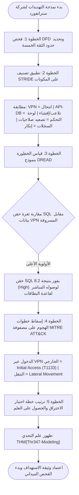

# غرفة نمذجة التهديدات لمختبري الاختراق (Threat Modeling for Pentesters)

---

## 1. نبذة عن الغرفة وسياقها التعليمي والأمني (Room Overview & Security Context)
تُمثل غرفة **Threat Modeling for Pentesters** المدخل الاستراتيجي للوحدة 17 ضمن مسار مختبر الاختراق المبتدئ (Jr Penetration Tester). تركز هذه الغرفة على إرساء المنهجيات الاحترافية التي تحول مهارات الاختراق التقنية إلى خطط عملياتية موجهة لخدمة أهداف الأعمال التجارية وحماية الأصول الحيوية.

في الاختبارات الميدانية للمؤسسات الكبرى (مثل المؤسسات المالية وشركات الدفع الإلكتروني)، يواجه مختبر الاختراق نطاقات عمل ضخمة تشمل عشرات التطبيقات وقواعد البيانات ومئات الخوادم ضمن فترات زمنية مقيدة (مثل 10 أيام عمل). يؤدي البدء العشوائي بفحص المنافذ إلى إهدار الوقت على أنظمة هامشية (مثل خوادم الطباعة الداخلية)، مع إغفال قواعد بيانات بطاقات الائتمان الحساسة. تقع نمذجة التهديدات في **المرحلة الثالثة من معيار تنفيذ اختبار الاختراق (PTES)**، وتعمل بوصفها "وثيقة توجيه واستهداف" تضمن توجيه جهود الفحص والاستغلال نحو أخطر مسارات الهجوم.

تعتمد الغرفة على سيناريو واقعي لشركة خدمات مالية (**Stratford Systems, Inc.**) تدير بوابة دفع إلكتروني (StratPay) تعالج بيانات أكثر من 200,000 بطاقة ائتمانية خاضعة لمعايير PCI DSS، وتستعرض كيفية تفكيك الأنظمة وتحديد التهديدات وتصنيفها وقياس خطورتها باستخدام أطر **STRIDE** و **DREAD** و **PASTA** و **MITRE ATT&CK**.

---

## 2. الأهداف التعليمية والمخرجات العملية (Learning Objectives)
عند إتمام هذه الغرفة، سيكون الباحث الأمني قادراً على:
1. استيعاب موقع نمذجة التهديدات ضمن معيار PTES (المرحلة الثالثة) ودورها في التخطيط العملياتي.
2. تطبيق الأسئلة العالمية الأربعة لنمذجة التهديدات (ما الذي نعمل عليه؟ ما الذي يمكن أن يفشل؟ ماذا سنفعل حياله؟ وهل قمنا بعمل جيد؟).
3. رسم وفهم مخططات تدفق البيانات (DFDs) وتحديد عناصرها الأساسية: العمليات (`Processes`)، ومستودعات البيانات (`Data Stores`)، والكيانات الخارجية (`External Entities`)، وتدفقات البيانات (`Data Flows`)، وحدود الثقة (`Trust Boundaries`).
4. تحليل التهديدات وتصنيفها منهجياً وفق نموذج **STRIDE** وربطها بالخصائص الأمنية المنتهكة.
5. حساب درجات الخطورة الكمية باستخدام نموذج **DREAD** والمقارنة بين أثر تعطل الخدمة المؤقت والسرقة الدائمة للبيانات.
6. فهم المراحل السبع لإطار **PASTA** القائم على مخاطر الأعمال ودمج استخبارات التهديدات (Threat Intelligence).
7. توظيف مصفوفة **MITRE ATT&CK** لربط مسارات الهجوم الواقعية بأساليب وتكتيكات المهاجمين.

---

## 3. المتطلبات المعمارية وتجهيز بيئة العمل (Prerequisites & Setup)
- **منصة المحاكاة التفاعلية:** معمل ويب تفاعلي لمحاكاة نمذجة التهديدات لشركة ستراتفورد متوفر عبر الرابط:
  `https://static-labs.tryhackme.cloud/sites/jr-pentester-threat-modelling/`
- **المعرفة المسبقة:** فهم بنيات الشبكات، وبروتوكول TCP/IP، وثغرات الويب الشائعة (SQLi و XSS)، ومفاهيم المصادقة والتفويض.
- **الأدوات المستخدمة:** متصفح الويب للوصول للمعمل التفاعلي، ونماذج DFD ومصفوفات حساب درجات DREAD.

---

## 4. المفاهيم النظرية العميقة والتحليل المعماري (Deep Theoretical Concepts)

### أ. مخططات تدفق البيانات (DFDs) وحدود الثقة:
لا تهتم DFDs بتفاصيل لغات البرمجة، بل تركز على حركة البيانات. تُرسم **حدود الثقة (Trust Boundaries)** كخطوط متقطعة (`Dashed Lines`) تفصل بين مستويات أمنية متباينة (مثل الخط الفاصل بين شبكة الإنترنت العامة ومنطقة الـ DMZ، أو بين الـ DMZ والشبكة الداخلية). تتركز معظم الثغرات الأمنية الحرجة عند نقاط عبور حدود الثقة لأن النظام ينتقل من افتراض عدم الثقة إلى منح الامتيازات.

### ب. تصنيف التهديدات بنموذج STRIDE:
ابتكرته شركة مايكروسوفت لربط كل تهديد بالخاصية الأمنية التي ينتهكها:
- **Spoofing (الانتحال):** ينتهك المصادقة (Authentication).
- **Tampering (التلاعب):** ينتهك السلامة وتكامل البيانات (Integrity).
- **Repudiation (الإنكار):** ينتهك عدم الإنكار والمساءلة (Non-Repudiation) كغياب سجلات الإخفاق.
- **Information Disclosure (إفشاء المعلومات):** ينتهك السرية (Confidentiality).
- **Denial of Service (حجب الخدمة):** ينتهك التوافرية (Availability).
- **Elevation of Privilege (تصعيد الامتيازات):** ينتهك التفويض والصلاحيات (Authorization).

عنصر **العملية (Process)** هو العنصر البرمجي الوحيد المعرض لكافة تهديدات STRIDE الستة دون استثناء.

### ج. حساب الخطورة بنموذج DREAD:
يعتمد على حساب المتوسط الحسابي لخمسة معايير رقمية (من 1 إلى 10):
$$\text{DREAD Score} = \frac{D + R + E + A + D}{5}$$
حيث: **Damage** (حجم الضرر)، **Reproducibility** (قابلية التكرار)، **Exploitability** (سهولة الاستغلال)، **Affected Users** (نسبة المستخدمين المتأثرين)، و **Discoverability** (سهولة اكتشاف الثغرة).

---

## 5. تحليل الكود وهندسة البرمجيات (Code Breakdown)

### أ. سيناريو المقارنة بين ثغرة حقن SQL وثغرة حجب الخدمة:
في تمرين DREAD، تمت مقارنة ثغرتين رئيسيتين:
1. **ثغرة حقن SQL في خانة البحث:**
   - تمنح وصولاً مباشراً لقاعدة البيانات الحساسة (200,000 بطاقة).
   - $D=9, R=8, E=7, A=9, D=8 \implies \text{النتيجة: } 8.2$ (درجة خطورة مرتفعة جداً تضعها في قمة أولويات الفحص).
2. **ثغرة حجب الخدمة (DoS):**
   - تعطل البوابة ولكن النظام يستعيد عمله تلقائياً فور إعادة التشغيل دون فقدان أو تسريب لأي بيانات.
   - تحصل على أدنى تقييم في معيار **حجم الضرر (Damage)** مقارنة بالمعايير الأخرى.

### ب. سلسلة الهجوم عبر مصفوفة MITRE ATT&CK:
```text
1. إرسال بريد تصيد احتيالي -> Initial Access (T1566.001)
2. سرقة بيانات اعتماد الموظف -> Credential Access (T1078)
3. الاتصال ببوابة VPN بالبيانات المسروقة -> Initial Access (T1133)
4. الوصول للوحة التحكم والتنقل داخلياً -> Lateral Movement (T1021)
5. استخراج بيانات البطاقات من خادم SQL -> Exfiltration (T1041)
```

---

## 6. خرائط التدفق ومخططات سير البيانات (Execution Flowcharts)



---

## 7. جدول المهام والحلول المعتمدة (Tasks & Verified Solutions Matrix)

| المهمة | عنوان المهمة | رقم السؤال | نص السؤال | الحل المعتمد | الشرح التقني والمفاهيمي |
|:---:|---|:---:|---|:---:|---|
| **01** | Introduction | Q1 | I am ready to learn about threat modeling! | `No answer needed` | إقرار البدء في دراسة سيناريو شركة ستراتفورد وتحديد نطاق العمل. |
| **02** | Four Questions and Frameworks | Q1 | What is the name of the framework that uses six threat categories including Spoofing and Tampering? | `STRIDE` | إطار العمل الشهير المطور في مايكروسوفت لتصنيف التهديدات المكون من 6 فئات. |
| **03** | The Building Blocks | Q1 | What DFD element is represented by a dashed line? | `Trust boundary` | الخط المتقطع يمثل حدود الثقة الفاصلة بين المناطق الأمنية ذات الصلاحيات المتباينة. |
| **03** | The Building Blocks | Q2 | Which DFD element type is used to represent application logic that transforms or acts on data? | `Process` | الدائرة تمثل العمليات والبرمجيات المنطقية التي تعالج وتغير البيانات. |
| **04** | STRIDE Systematic Identification | Q1 | Which STRIDE category directly violates the security property of integrity? | `Tampering` | فئة التلاعب تمثل التعديل غير المصرح به على البيانات أثناء النقل أو التخزين. |
| **04** | STRIDE Systematic Identification | Q2 | During your STRIDE analysis... you discover that the application does not log failed authentication attempts... | `Repudiation` | غياب السجلات يمنع المحاسبة والمساءلة ويمكن المهاجم من إنكار أفعاله. |
| **04** | STRIDE Systematic Identification | Q3 | According to the DFD-to-STRIDE mapping table, which DFD element type is susceptible to all six STRIDE categories? | `Process` | العمليات البرمجية هي المكون الوحيد المعرض لجميع تهديدات STRIDE الستة. |
| **05** | Scoring Threats with DREAD | Q1 | What does the "A" in DREAD stand for? | `Affected Users` | المعيار الرابع في نموذج DREAD لقياس نسبة المستخدمين المتأثرين بالاستغلال. |
| **05** | Scoring Threats with DREAD | Q2 | You are scoring a Denial of Service vulnerability... Which DREAD category would receive the lowest score? | `Damage` | تعطل الخدمة المؤقت مع الاستعادة التلقائية دون تسريب بيانات يجعل الضرر منخفضاً جداً. |
| **06** | PASTA Risk-Centric Modeling | Q1 | After completing your threat model, the client asks your pentest team to justify why you are prioritizing the payment portal... | `Stage 7` | المرحلة السابعة (تحليل المخاطر والأثر) تقدم الأدلة المالية والتنظيمية لتبرير الفحص. |
| **06** | PASTA Risk-Centric Modeling | Q2 | During a PASTA analysis... threat intelligence reports show a 300% increase in API-targeted attacks... | `Stage 4` | المرحلة الرابعة (تحليل التهديدات) مخصصة لدمج استخبارات التهديدات الخاصة بالقطاع. |
| **07** | MITRE ATT&CK Modeling | Q1 | How many tactics are in the MITRE ATT&CK Enterprise matrix (v18)? | `14` | تضم المصفوفة المؤسسية لميتر 14 تكتيكاً تمثل الأهداف المرحلية للمهاجمين. |
| **07** | MITRE ATT&CK Modeling | Q2 | What is the first ATT&CK tactic (alphabetically) that has no direct equivalent in the Cyber Kill Chain? | `Credential Access` | التكتيك الأول أبجدياً بين التكتيكات الخمسة المخصصة للعمليات الداخلية بعد الاختراق. |
| **08** | Putting It All Together | Q1 | In the DREAD scoring exercise (Step 3), which of the two threats received the higher risk rating...? | `SQL injection` | حقن SQL نال تقييم 8.2 لوصوله المباشر لبيانات البطاقات متفوقاً على بيانات VPN. |
| **08** | Putting It All Together | Q2 | In the ATT&CK mapping exercise (Step 4), which tactic did you assign to the step where the attacker uses stolen VPN credentials...? | `Initial Access` | الوصول من الإنترنت الخارجي إلى الشبكة الداخلية يصنف كتكتيك نفاذ أولي (T1133). |
| **08** | Putting It All Together | Q3 | What flag did you get after going through all the steps? | `THM{Thr347-Modeling}` | علم إتمام تمرين نمذجة التهديدات المستخرج بعد إنهاء الخطوات الخمس بنجاح. |
| **09** | Conclusion | Q1 | Congratulations on finishing this room. It is time to join Planning and Scoping. | `No answer needed` | إقرار اكتمال الغرفة واعتبار نموذج التهديدات وثيقة حية توجه الفحص والتقارير. |

---

## 8. الاعتبارات التشغيلية والأمنية لمختبري الاختراق (OpSec & Offensive Scripting)
1. **تجنب استنزاف الوقت في الفحص الأعمى:** نمذجة التهديدات توفر ما بين 30% إلى 50% من وقت الفحص عبر توجيه الاختبار نحو الثغرات الأكثر تأثيراً على أهداف العميل الحيوية.
2. **الحفاظ على التخفي وتجنب إثارة تنبيهات الـ SOC مبكراً:** بدلاً من إطلاق أدوات فحص تلقائية تصدر ضجيجاً شبكياً كبيراً، يركز الباحث على استغلال الثغرات الحرجة المحددة في شجرة الهجوم (مثل حقن SQL في بوابة الدفع) بطلبات مخصصة ومعدودة.
3. **الالتزام بحدود الامتثال القانوني (PCI DSS Scope):** تساعد حدود الثقة في استبعاد الخوادم الخارجية غير المصرح بفحصها لتجنب المساءلة الجنائية.

---

## 9. الثغرات الشائعة والبرمجة الدفاعية (Defensive Hardening)
- **إغفال ثغرات سجلات الأحداث (Repudiation Gaps):** عدم تسجيل محاولات تسجيل الدخول الفاشلة يعمي فرق الاستجابة للحوادث عن رصد هجمات التخمين. **المعالجة:** تفعيل السجلات المركزية المشفرة.
- **الاعتماد على إخفاء الثغرات (Discoverability Fallacy):** افتراض أن الثغرة آمنة لمجرد صعوبة العثور عليها هو خطأ جسيم. يجب معالجة الثغرات جذرياً عبر التحقق من المدخلات ومبدأ الامتيازات الأقل.

---

## 10. التحليل المقارن (Comparative Analysis)

| إطار العمل | المنظور الأساسي | نقاط القوة | نقاط الضعف | الاستخدام المثالي |
|---|---|---|---|---|
| **STRIDE** | معماري / مكوّنات برمجية | شامل ومنهجي ويغطي كافة الخصائص الأمنية | يفتقر للسياق التجاري وأثر الأعمال | تصميم البرمجيات ومراجعة الشفرات |
| **DREAD** | قياس كمي للمخاطر | يعطي درجات رقمية سهلة الترتيب | التقييم الذاتي لمعيار الاكتشاف | ترتيب أولويات الثغرات المكتشفة |
| **PASTA** | مبني على مخاطر الأعمال | يربط الثغرات بالخسائر المالية والامتثال | معقد ويستغرق وقتاً طويلاً | التخطيط الاستراتيجي لاختبار الاختراق |
| **MITRE ATT&CK** | تكتيكات وسلوك المهاجمين | واقعي ومبني على أدلة رصد ميدانية حية | يركز على سلوكيات ما بعد الاختراق | محاكاة الخصوم واختبار كفاءة الدفاعات |

---

## 11. تمارين عملية إضافية وسيناريوهات هجومية (Hands-on Exercises)
1. **تمرين 1: بناء شجرة هجوم لاستخراج الرواتب:**
   رسم شجرة هجوم (Attack Tree) تستهدف خادم الرواتب المحمي بـ VPN وتحديد المسار الأقل تكلفة للمهاجم.
2. **تمرين 2: نمذجة تهديدات تطبيق موبايل بـ DFD Level 1:**
   تفكيك تطبيق مصرفي للهواتف الذكية وتحديد حدود الثقة بين التطبيق وخادم الـ API وسحابة الإشعارات.

---

## 12. الأسئلة الشائعة وتصحيح المفاهيم المغلوطة (FAQ)
- **س: هل الدخول عبر VPN ببيانات مسروقة يعتبر حركة جانبية (Lateral Movement)؟**
  - **ج:** لا؛ الدخول من خارج الشبكة (الإنترنت) إلى الداخل باستخدام بيانات صالحة يصنف في ATT&CK كتكتيك **نفاذ أولي (Initial Access - T1133)**.
- **س: لماذا تفوقت ثغرة حقن SQL على بيانات VPN في تقييم DREAD؟**
  - **ج:** لأن حقن SQL يمنح وصولاً فورياً وغير مصرح به لأرقام البطاقات الحساسة، بينما يتطلب الـ VPN خطوات إضافية للوصول لنفس البيانات.

---

## 13. مسرد المصطلحات التقنية (Technical Glossary)
- **Threat Modeling (نمذجة التهديدات):** عملية منهجية لتحديد وتقييم التهديدات الأمنية وتحديد الضوابط الوقائية.
- **Trust Boundary (حدود الثقة):** خط فاصل بين منطقتين أمنيتين تختلفان في مستويات الامتيازات أو السيطرة الإدارية.
- **Attack Tree (شجرة الهجوم):** تمثيل تخطيطي شجري يحلل مسارات تحقيق هدف هجومي محدد.
- **PTES:** معيار تنفيذ اختبار الاختراق المكون من 7 مراحل رئيسية.

---

## 14. المراجع والمصادر التوثيقية (Authoritative References)
1. **Threat Modeling Manifesto (2020):** `https://www.threatmodelingmanifesto.org/`.
2. **MITRE ATT&CK Enterprise Matrix v18:** `https://attack.mitre.org/`.
3. **VerSprite PASTA Framework:** Risk-Centric Threat Modeling Guide.
4. **TryHackMe Room:** Threat Modeling for Pentesters (`https://tryhackme.com/room/threatmodelingforpentesters`).
