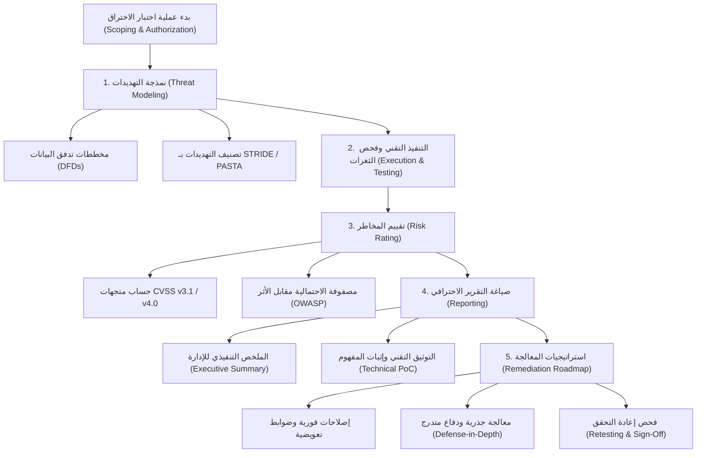

# الوحدة 17: منهجيات اختبار الاختراق وإعداد التقارير (Pentesting Methodologies and Reporting)

## نظرة عامة على الوحدة التعليمية
تُمثل المهارات التقنية في استغلال الثغرات نصف مهام مختبر الاختراق المحترف فقط. في البيئات المؤسسية والشركات العالمية، لا قيمة لاكتشاف الثغرات ما لم يتم تأطيرها ضمن منهجيات نمذجة التهديدات (Threat Modeling)، وتقييم مخاطرها التجارية بدقة، وتوثيقها بوضوح في تقارير احترافية موجهة للإدارة التنفيذية والفرق التقنية، وتزويد المؤسسة بخطط معالجة وحماية عملية ومستدامة.

تُقاس جودة اختبار الاختراق في نهاية المطاف بـ **المخرجات والتقارير المسلمة (Deliverables)**: الملخص التنفيذي، وتقييم درجات الخطورة، وإثباتات الاستغلال (Proof of Concept)، وإرشادات الحماية الدفاعية المتدرجة.

تغطي هذه الوحدة دورة المنهجيات والتقارير الكاملة عبر 5 غرف رئيسية:
1. **نمذجة التهديدات لمختبري الاختراق (Threat Modeling for Pentesters):** تفكيك الأنظمة وتحديد حدود الثقة ومنافذ الدخول وأهداف المهاجمين قبل بدء الفحص باستخدام أطر STRIDE و PASTA ومخططات تدفق البيانات (DFD).
2. **كتابة تقارير اختبار الاختراق (Writing Pentest Reports):** صياغة التقارير التجارية التي تجمع بين مخاطر الأعمال الموجهة للمديرين التنفيذيين والخطوات التقنية المفصلة لإعادة إنتاج الثغرات.
3. **تقييم درجات خطورة الثغرات (Vulnerability Risk Rating):** القياس الكمي والنوعي للخطورة باستخدام نظام CVSS v3.1 و CVSS v4.0، ومصفوفات الاحتمالية والأثر (Likelihood $\times$ Impact)، ومنهجية OWASP.
4. **استراتيجيات المعالجة والتخفيف (Remediation and Mitigation Strategies):** صياغة خطط الدفاع المتدرج (Defense-in-Depth)، والضوابط التعويضية (Compensating Controls)، وتصحيح الثغرات وضمان عدم تكرارها.
5. **المراجعة التقييمية الشاملة (Topic Transition Recap):** تقييم نظري وعملي شامل يثبت استيعاب منهجيات اختبار الاختراق، وحساب درجات الخطورة، وكتابة التقارير الاحترافية.

---

## فهرس غرف الوحدة والمواضيع المغطاة

| رقم الغرفة | اسم المجلد | الاسم البرمجي (Slug) | نوع الغرفة | الوصف الأكاديمي والعملي |
|:---:|---|---|:---:|---|
| **01** | `01-THREAT-MODELING-FOR-PENTESTERS` | `threatmodelingforpentesters` | معمل تطبيقي | منهجيات نمذجة التهديدات، STRIDE، PASTA، مخططات تدفق البيانات، وحدود الثقة. |
| **02** | `02-WRITING-PENTEST-REPORTS` | `writingpentestreports` | معمل تطبيقي | هيكلية التقارير، الملخص التنفيذي، توثيق الثغرات، وإثباتات المفهوم (PoC). |
| **03** | `03-VULNERABILITY-RISK-RATING` | `vulnerabilityriskrating` | معمل تطبيقي | تقييم المخاطر الكمي والنوعي: متجهات CVSS، مصفوفات المخاطر، ومنهجية OWASP. |
| **04** | `04-REMEDIATION-AND-MITIGATION-STRATEGIES` | `remediationandmitigationstrategies` | معمل تطبيقي | خطط المعالجة الاستراتيجية، الضوابط التعويضية، وإدارة التحديثات الدفاعية. |
| **05** | `05-TOPIC-TRANSITION-RECAP` | `recap` | تقييم شامل | تقييم شامل يقيس الكفاءة المنهجية وحساب الخطورة وصياغة التقارير. |

---

## البنية الهندسية لمنهجيات اختبار الاختراق وإعداد التقارير

---

## معايير الجودة الأكاديمية والعملية
تلتزم جميع غرف هذه الوحدة بالمعايير الصارمة التالية:
1. **هيكل الـ 14 قسماً المعتمد:** توثيق شامل باللغتين العربية والإنجليزية.
2. **منهجية المراحل السبع للمهام (Stages A-G):** تفكيك كل مهمة وسؤال من المبادئ الأولى لشرح كيفية تحديد المخاطر وتقييمها.
3. **أمثلة واقعية وقوالب جاهزة:** نماذج تقارير حقيقية، ومتجهات CVSS محللة، وقوالب لإثبات المفهوم والملخصات التنفيذية.
