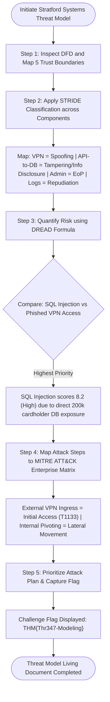

# Room 01: Threat Modeling for Pentesters — Comprehensive Technical Documentation

---

## 1. Room Overview & Security Context
The **Threat Modeling for Pentesters** room introduces the strategic methodologies governing professional penetration testing engagements within the Jr Penetration Tester path on TryHackMe. In commercial consulting, discovering technical vulnerabilities is ineffective unless aligned with business risk and operational priorities.

When conducting enterprise security assessments for large organizations (such as financial institutions and payment gateways), testers receive extensive scopes encompassing dozens of web applications, database clusters, APIs, and Active Directory domains within strict time windows (e.g., 10 business days). Firing automated scanners indiscriminately wastes billable hours on non-critical periphery (such as internal printers or static landing pages) while critical crown-jewel assets—such as customer payment databases—remain untested. Situated in **Phase 3 of the Penetration Testing Execution Standard (PTES)**, threat modeling acts as an architectural targeting mechanism that transforms expansive scopes into prioritized, risk-aligned attack plans.

This room works through an authentic commercial scenario for **Stratford Systems, Inc.**, a financial services company operating the StratPay portal handling payment processing for over 200,000 credit card accounts under PCI DSS scope. It guides security practitioners through system decomposition, threat identification, severity scoring, and attack path prioritization using **STRIDE**, **DREAD**, **PASTA**, and **MITRE ATT&CK**.

---

## 2. Learning Objectives & Practical Outcomes
Upon completing this room, security practitioners and penetration testers will be able to:
1. Explain the operational placement of Threat Modeling within Phase 3 of the PTES lifecycle.
2. Apply the Four Universal Questions of threat modeling (What are we working on? What can go wrong? What are we going to do about it? Did we do a good enough job?).
3. Construct and analyze Level 1 Data Flow Diagrams (DFDs) identifying Processes, Data Stores, Data Flows, External Entities, and Trust Boundaries.
4. Systematically identify vulnerabilities across software components using the Microsoft **STRIDE** model.
5. Quantify and rank threat severity using the **DREAD** scoring formula, differentiating temporary availability disruptions from catastrophic data breaches.
6. Navigate the 7 stages of the **PASTA** risk-centric framework, integrating industry-specific threat intelligence (Stage 4) and business impact quantification (Stage 7).
7. Map threat actor pathways to the 14 enterprise tactics of **MITRE ATT&CK (v18)**, distinguishing internal post-compromise tactics from perimeter access.

---

## 3. Architectural Prerequisites & Environment Setup
- **Simulation Environment:** Interactive threat modeling portal accessible at:
  `https://static-labs.tryhackme.cloud/sites/jr-pentester-threat-modelling/`
- **Technical Prerequisites:** Foundational knowledge of network architecture, TCP/IP, web vulnerabilities (SQL injection, XSS), and authentication mechanisms.
- **Tooling:** Modern web browser to complete the interactive exercise, alongside DFD mapping and DREAD calculation matrices.

---

## 4. Deep Theoretical Concepts & Architectural Analysis

### A. Data Flow Diagrams (DFDs) and Trust Boundaries:
Data Flow Diagrams provide an abstraction of system functionality focused entirely on data movement. In standard notation (Gane-Sarson / Yourdon):
- **Processes** are depicted as circles or rounded rectangles.
- **Trust Boundaries** are depicted as **dashed lines**.
A trust boundary demarcates the perimeter where privileges change (e.g., Internet to DMZ, or DMZ to Internal Database Zone). Trust boundaries are the primary focus of penetration testers because crossing them requires unauthenticated or untrusted input to be accepted by higher-privilege systems.

### B. STRIDE Threat Categorization:
STRIDE categorizes threats based on the security property they violate:
- **Spoofing:** Violates Authentication (impersonating a user or machine).
- **Tampering:** Violates Integrity (modifying parameters, network packets, or records).
- **Repudiation:** Violates Non-Repudiation (performing actions without audit trails).
- **Information Disclosure:** Violates Confidentiality (leaking credentials, PII, or card data).
- **Denial of Service:** Violates Availability (crashing services or exhausting resources).
- **Elevation of Privilege:** Violates Authorization (escalating permissions from user to admin).
Crucially, **Process** elements are susceptible to all six STRIDE categories.

### C. DREAD Quantitative Risk Scoring:
Calculates the arithmetic mean across five operational dimensions:
$$\text{DREAD Score} = \frac{D + R + E + A + D}{5}$$
Where **Damage**, **Reproducibility**, **Exploitability**, **Affected Users**, and **Discoverability** are scored from 1 to 10. A score of 9.0–10.0 represents Critical risk; 7.0–8.9 represents High risk; 4.0–6.9 represents Medium risk; and 1.0–3.9 represents Low risk.

---

## 5. Code Breakdown & Software Engineering

### A. DREAD Threat Comparison (SQL Injection vs DoS):
During the Stratford Systems simulation, two primary vulnerabilities were scored:
1. **SQL Injection in Payment Search:**
   - Unauthenticated direct access to 200,000 credit card records in the database.
   - $D=9, R=8, E=7, A=9, D=8 \implies \text{Score: } 8.2 \text{ (High Severity)}$.
   - Prioritized at the top of the test plan due to severe financial and regulatory penalties under PCI DSS.
2. **Denial of Service (DoS):**
   - Readily reproducible by external actors without credentials, impacting all customers.
   - However, it produces zero data loss, leaves records intact, and recovers automatically on process restart.
   - Therefore, the **Damage** metric receives the lowest score among all five dimensions.

### B. Attack Path Mapping via MITRE ATT&CK:
```text
1. Spear-phishing email with malicious payload -> Initial Access (T1566.001)
2. Harvest employee active credentials -> Credential Access (T1078)
3. Authenticate to External VPN Gateway -> Initial Access (T1133)
4. Pivot via Internal Admin Dashboard -> Lateral Movement (T1021)
5. Exfiltrate Credit Card Data from SQL DB -> Exfiltration (T1041)
```

---

## 6. Flowcharts & Execution Lifecycles



---

## 7. Tasks & Verified Solutions Matrix

| Task # | Task Title | Question # | Question String | Verified Solution | Technical & Architectural Rationale |
|:---:|---|:---:|---|:---:|---|
| **01** | Introduction | Q1 | I am ready to learn about threat modeling! | `No answer needed` | Scoping context and engagement background acknowledgment. |
| **02** | Four Questions and Frameworks | Q1 | What is the name of the framework that uses six threat categories including Spoofing and Tampering? | `STRIDE` | Microsoft framework classifying threats into 6 categories based on violated security properties. |
| **03** | The Building Blocks | Q1 | What DFD element is represented by a dashed line? | `Trust boundary` | Delineates the boundary where security privileges and administrative trust levels change. |
| **03** | The Building Blocks | Q2 | Which DFD element type is used to represent application logic that transforms or acts on data? | `Process` | Circular DFD element representing executable software code and compute logic. |
| **04** | STRIDE Systematic Identification | Q1 | Which STRIDE category directly violates the security property of integrity? | `Tampering` | Unauthorized modification of data in transit or at rest violates system integrity. |
| **04** | STRIDE Systematic Identification | Q2 | During your STRIDE analysis... you discover that the application does not log failed authentication attempts... | `Repudiation` | Missing audit trails prevent accountability and non-repudiation of malicious actions. |
| **04** | STRIDE Systematic Identification | Q3 | According to the DFD-to-STRIDE mapping table, which DFD element type is susceptible to all six STRIDE categories? | `Process` | Software processes execute dynamic instructions and face all six STRIDE threats. |
| **05** | Scoring Threats with DREAD | Q1 | What does the "A" in DREAD stand for? | `Affected Users` | Fourth metric measuring the proportion of users impacted by an exploit. |
| **05** | Scoring Threats with DREAD | Q2 | You are scoring a Denial of Service vulnerability... Which DREAD category would receive the lowest score? | `Damage` | Zero data loss and automatic recovery upon restart results in minimal permanent damage. |
| **06** | PASTA Risk-Centric Modeling | Q1 | After completing your threat model, the client asks your pentest team to justify why you are prioritizing the payment portal... | `Stage 7` | Stage 7 (Risk and Impact Analysis) calculates financial and regulatory business exposure. |
| **06** | PASTA Risk-Centric Modeling | Q2 | During a PASTA analysis... threat intelligence reports show a 300% increase in API-targeted attacks... | `Stage 4` | Stage 4 (Threat Analysis) ingests industry-specific threat intelligence and actor profiles. |
| **07** | MITRE ATT&CK Modeling | Q1 | How many tactics are in the MITRE ATT&CK Enterprise matrix (v18)? | `14` | The Enterprise Matrix defines 14 core tactical goals from Reconnaissance to Impact. |
| **07** | MITRE ATT&CK Modeling | Q2 | What is the first ATT&CK tactic (alphabetically) that has no direct equivalent in the Cyber Kill Chain? | `Credential Access` | First alphabetical tactic among the five internal post-compromise behavioral categories. |
| **08** | Putting It All Together | Q1 | In the DREAD scoring exercise (Step 3), which of the two threats received the higher risk rating...? | `SQL injection` | Direct unauthenticated access to 200,000 cardholder records scores 8.2 (High). |
| **08** | Putting It All Together | Q2 | In the ATT&CK mapping exercise (Step 4), which tactic did you assign to the step where the attacker uses stolen VPN credentials...? | `Initial Access` | Authenticating from the external Internet to an internal gateway maps to Initial Access (T1133). |
| **08** | Putting It All Together | Q3 | What flag did you get after going through all the steps? | `THM{Thr347-Modeling}` | Proof of completion flag generated upon successful execution of the 5-step simulation. |
| **09** | Conclusion | Q1 | Congratulations on finishing this room. It is time to join Planning and Scoping. | `No answer needed` | Consolidates threat models as living documents guiding testing and reporting. |

---

## 8. OpSec & Offensive Scripting Considerations
1. **Targeted Efficiency:** Threat modeling eliminates 30–50% of wasted scanning time by zeroing in on high-impact attack paths directly aligned with client crown-jewel assets.
2. **Defensive Telemetry Awareness:** Knowing where trust boundaries lie allows testers to craft low-volume, targeted exploit payloads rather than triggering noisy perimeter IDS alarms.
3. **Strict Compliance to Scoping Limits:** Trust boundaries clearly isolate third-party external APIs (e.g., cloud payment processors) that must be excluded from active exploitation to prevent legal violations.

---

## 9. Common Vulnerabilities & Defensive Hardening
- **Repudiation Blind Spots:** Applications failing to log failed authentication attempts blind SOC incident responders to credential stuffing attacks. **Hardening:** Implement tamper-evident, centralized security logging.
- **Security Through Obscurity Fallacy:** Deprecating Discoverability in modern risk scoring prevents organizations from ignoring obscure vulnerabilities that motivated attackers will eventually uncover.

---

## 10. Comparative Analysis: Threat Modeling Frameworks

| Framework | Core Perspective | Strengths | Limitations | Optimal Use Case |
|---|---|---|---|---|
| **STRIDE** | Software Component | Exhaustive, systematic component coverage | Lacks business risk and financial context | Application design & secure code reviews |
| **DREAD** | Quantitative Scoring | Produces easy-to-rank numerical scores | Subjectivity in Discoverability rating | Prioritizing technical vulnerability backlogs |
| **PASTA** | Business Risk Centric | Directly links technical flaws to financial loss | Process-heavy and time-intensive | Strategic pentest planning & C-suite alignment |
| **MITRE ATT&CK** | Adversary Behavior | Based on empirical real-world threat actor TTPs | Focuses heavily on post-compromise actions | Red teaming, threat hunting, and defense evals |

---

## 11. Hands-on Extended Exercises & Offensive Scenarios
1. **Exercise 1: Attack Tree for Payroll Server Compromise:**
   Construct an Attack Tree modeling adversary paths targeting an internal HR payroll server, identifying the path of least resistance.
2. **Exercise 2: Mobile Banking App DFD Mapping:**
   Decompose a mobile banking application into Level 1 DFDs, identifying trust boundaries between the mobile client, API gateway, and core banking mainframe.

---

## 12. FAQ & Misconception Debunking
- **Q: Why is VPN ingress classified as Initial Access instead of Lateral Movement?**
  - **A:** An attacker operating from the public Internet who authenticates to an external remote service (VPN) is breaching the perimeter, mapping directly to **Initial Access (T1133)**.
- **Q: Why did SQL injection outscore VPN credential access in DREAD?**
  - **A:** Direct SQL injection immediately exposes 200,000 credit card records in the database, whereas VPN access still requires subsequent internal enumeration and privilege escalation to reach the data.

---

## 13. Technical Glossary
- **Threat Modeling:** The structured engineering process of identifying, enumerating, and mitigating system threats.
- **Trust Boundary:** A physical or logical line delineating transitions between different security trust zones.
- **Attack Tree:** A hierarchical diagram representing conditions and pathways required to achieve an attacker objective.
- **PTES:** Penetration Testing Execution Standard, defining 7 core phases of penetration testing.

---

## 14. Authoritative References & Further Reading
1. **Threat Modeling Manifesto (2020):** `https://www.threatmodelingmanifesto.org/`.
2. **MITRE ATT&CK Enterprise Matrix v18:** `https://attack.mitre.org/`.
3. **VerSprite PASTA Framework:** Risk-Centric Threat Modeling Guide.
4. **TryHackMe Official Room:** Threat Modeling for Pentesters (`https://tryhackme.com/room/threatmodelingforpentesters`).
