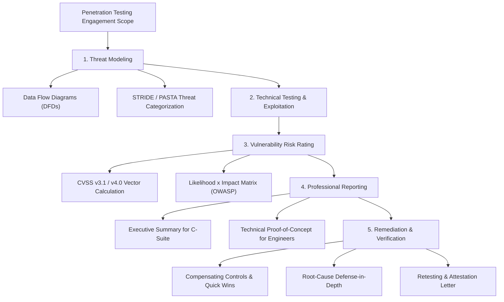

# Module 17: Pentesting Methodologies and Reporting — Technical Documentation

## Module Overview
Technical exploitation represents only one dimension of a penetration tester's role. In enterprise consulting and commercial engagements, identifying critical vulnerabilities provides no value unless findings are structured through formal threat modeling, accurately prioritized based on organizational risk, articulated persuasively in professional documentation, and matched with actionable defensive remediation roadmaps.

A penetration test is ultimately judged by its **Deliverables**: the executive summary, vulnerability risk ratings, reproducible proof-of-concept steps, and remediation roadmaps delivered to executive and technical leadership.

This module provides comprehensive coverage of the professional methodology and reporting lifecycle across 5 core rooms:
1. **Threat Modeling for Pentesters (`threatmodelingforpentesters`):** Deconstructing systems to identify potential threats, trust boundaries, entry points, and threat actor profiles before active testing begins (using STRIDE, PASTA, and Data Flow Diagrams).
2. **Writing Pentest Reports (`writingpentestreports`):** Crafting commercial-grade deliverables that bridge high-level executive risk with granular technical proof-of-concept steps, timelines, and remediation guidance.
3. **Vulnerability Risk Rating (`vulnerabilityriskrating`):** Quantifying vulnerability severity using standard scoring systems (CVSS v3.1 and v4.0 vectors, OWASP Risk Rating Methodology, and qualitative Likelihood $\times$ Impact matrices).
4. **Remediation and Mitigation Strategies (`remediationandmitigationstrategies`):** Developing strategic defensive roadmaps, compensating controls, defense-in-depth principles, patching schedules, and retesting protocols.
5. **Topic Transition Recap (`recap`):** Comprehensive validation assessment evaluating methodology mastery, risk scoring, reporting standards, and mitigation design.

---

## Room Directory & Curriculum Mapping

| Room # | Directory Name | Canonical Slug | Type | Description |
|:---:|---|---|:---:|---|
| **01** | `01-THREAT-MODELING-FOR-PENTESTERS` | `threatmodelingforpentesters` | Walkthrough / Lab | Threat modeling methodologies, STRIDE, PASTA, DFDs, and trust boundary mapping. |
| **02** | `02-WRITING-PENTEST-REPORTS` | `writingpentestreports` | Walkthrough / Lab | Report architecture, executive summaries, technical finding documentation, and PoC steps. |
| **03** | `03-VULNERABILITY-RISK-RATING` | `vulnerabilityriskrating` | Walkthrough / Lab | Quantitative & qualitative risk scoring: CVSS v3.1/v4.0 vectors, matrices, and OWASP methodology. |
| **04** | `04-REMEDIATION-AND-MITIGATION-STRATEGIES` | `remediationandmitigationstrategies` | Walkthrough / Lab | Strategic defensive remediation, compensating controls, patch management, and retesting. |
| **05** | `05-TOPIC-TRANSITION-RECAP` | `recap` | Assessment | Practical assessment measuring methodology mastery, risk rating accuracy, and reporting standards. |

---

## Professional Methodology Architecture

---

## Engineering & Documentation Standards
All rooms within this module adhere strictly to:
- **14-Section Documentation Standard:** Dual-language technical guides (`README_AR.md`, `README_EN.md`), operational checklists, and MITRE ATT&CK / NIST alignments.
- **7-Stage Task Methodology (Stages A–G):** Deep pedagogical deconstruction explaining underlying risk factors, metric weights, and governance rationales rather than merely outputting template strings.
- **Commercial Deliverable Templates:** Fully articulated report templates, CVSS calculator breakdowns, and realistic remediation checklists.
