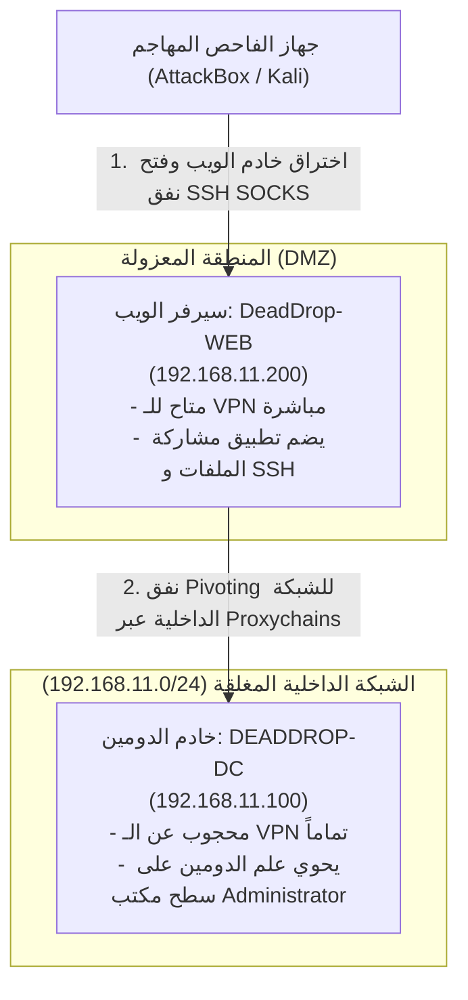

# المهمة 01: نطاق وسيناريو عملية الصندوق الميت (Dead Drop Scoping)

---

## 📌 1. الفكرة العامة والسيناريو الميداني (Scenario Overview)

في هذا التحدي المتكامل، نقوم بمحاكاة اختبار اختراق لشركة **DeadDrop Ltd** المتخصصة في حفظ ومشاركة الملفات السحابية. 
تتميز بيئة الشركة بوجود تقسيم شبكي احترافي (Network Segmentation):
* **المنطقة المعزولة (DMZ):** تحتوي على خادم الويب العام `DeadDrop-WEB` (عنوانه: `192.168.11.200`)، وهو السيرفر الوحيد الذي يمكن الوصول إليه مباشرة عبر اتصال الـ VPN.
* **الشبكة الداخلية المغلقة (Internal Corporate LAN):** شبكة الدومين الداخلية (`192.168.11.0/24`)، وهي محجوبة تماماً عن العالم الخارجي وعن شبكة الـ VPN بواسطة جدار حماية (Firewall). تحتوي هذه الشبكة على أجهزة الموظفين وخادم إدارة الهوية والـ Active Directory الرئيسي: **`DEADDROP-DC`** (عنوانه: `192.168.11.100`).

---

## 🗺️ 2. المخطط الشبكي ومسار التحرك (Pivoting Architecture)

---

## 🎯 3. متطلبات المهمة وقواعد الاشتباك (Rules of Engagement)
* **المطلوب في هذه المهمة:** تأكيد الاتصال بالمعمل واستيعاب البنية المعمارية للشبكة وطبيعة التحرك الجانبي (Pivoting).
* **الإجابة المطلوبة:** لا تتطلب إدخالاً نصياً (`Completed`).
