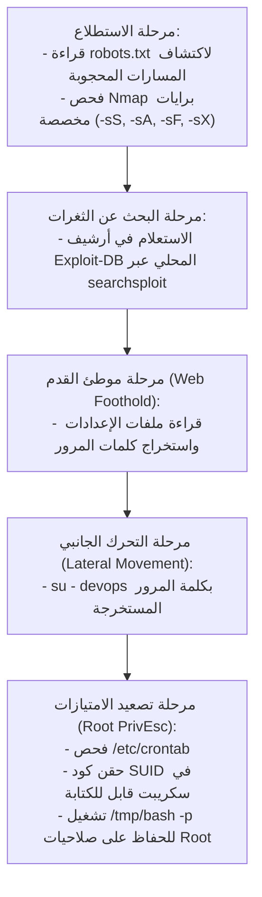

# توثيق مراجعة وتقييم الانتقال: تحديات المبتدئ العملية (Module 18 Topic Transition Recap)

---

## 1. الترويسة الموحدة ومعلومات التقييم (Metadata Header)
- **اسم الغرفة / التقييم:** Topic Transition Recap (مراجعة وتقييم الانتقال)
- **المسار التعليمي (Path):** Jr Penetration Tester (مخترق التطبيقات والمواقع المبتدئ)
- **الموديول (Module):** Module 18: Jr Pentester Challenges (تحديات المبتدئ العملية)
- **الترتيب داخل الموديول:** Room 08 of 08 (المحطة الختامية للمسار بالكامل)
- **معرف التقييم (Recap ID):** `6afe01c8b7a1485ac0cf8ade`
- **نوع التقييم:** Comprehensive Assessment / Knowledge Verification
- **الرابط الرسمي:** [https://tryhackme.com/recap/6afe01c8b7a1485ac0cf8ade](https://tryhackme.com/recap/6afe01c8b7a1485ac0cf8ade)
- **حالة الإنجاز للمستخدم:** مكتمل بنسبة 100% (48 / 48 نقطة كاملة)

---

## 2. الملخص التنفيذي وسياق السيناريو (Executive Summary & Scenario Context)
يمثل هذا التقييم الختامي مسك الختام لمسار **Jr Penetration Tester** كاملاً، حيث يقيس مستوى الفهم النظري والتطبيقي المستخلص من غرف وتحديات موديول التحديات العملية. يختبر التقييم قدرة المختبر على الربط بين مراحل الاختراق المختلفة (Cyber Kill Chain): بدءاً من الاستطلاع والاستكشاف السلبي عبر ملفات `robots.txt`، والبحث في قواعد بيانات الثغرات المحلية عبر `searchsploit` دون الحاجة للإنترنت، وتحليل رايات حزم TCP في أداة `nmap`، وانتهاءً بتسلسل استغلال الثغرات وتصعيد الامتيازات عبر إعادة استخدام بيانات الاعتماد وحقن المهام المجدولة وتفادي إسقاط صلاحيات Bash بواسطة المعامل `-p`.

---

## 3. الأهداف التعليمية والمفاهيم النظرية (Learning Objectives & Theoretical Concepts)
1. **التسلسل المنهجي لسلسلة الهجوم (Attack Chain Sequencing):** ترتيب الخطوات العملية من الحصول على موطئ قدم (Foothold) إلى الوصول للمستخدم الجذري (Root).
2. **آليات صيانة صلاحيات الـ SUID في صدفة Bash:** فهم سبب إسقاط Bash لصلاحيات الـ EUID وكيفية الحفاظ عليها باستخدام راية `-p`.
3. **الاستعلام في قواعد بيانات الثغرات دون إنترنت (Air-gapped Exploit Searching):** فهم البنية المعمارية لأداة `searchsploit` واعتمادها على أرشيف Exploit-DB المحلي.
4. **الاستطلاع واستكشاف المسارات الحساسة (Passive Reconnaissance):** الدور الحقيقي لملفات `robots.txt` في كشف البنية التحتية والمجلدات التي يرغب المدير في إخفائها.
5. **تحليل رايات TCP في فحوصات Nmap (TCP Flag Mechanics):** التمييز الدقيق بين رايات الفحص المتنوعة (`-sA`, `-sS`, `-sX`, `-sF`).
6. **تفسير أخطاء نظام الملفات في لينكس (Filesystem Error Handling):** التمييز بين غياب الملف ورفض إذن الوصول إليه.

---

## 4. البنية التقنية ومخطط مفاهيم التقييم (Assessment Concept Architecture)



---

## 5. مصفوفة الثغرات والتصنيفات القياسية (Vulnerability Matrix & CWE Mappings)

| المفهوم المختبر | التصنيف القياسي (CWE) | تصنيف ميتري (MITRE ATT&CK) | مستوى الأهمية |
|-----------------|-----------------------|----------------------------|---------------|
| Hardcoded Credentials in Web Config | CWE-798: Hard-coded Credentials | T1552.001: Credentials in Files | High |
| Insecure Scheduled Job Permissions | CWE-732: Incorrect Permission Assignment | T1053.003: Scheduled Task/Cron | Critical |
| SUID Privilege Misconfiguration | CWE-250: Execution with Unnecessary Privileges | T1548.001: Setuid and Setgid | Critical |
| Information Leakage via Disallowed Paths | CWE-200: Information Exposure | T1592: Gather Victim Host Info | Low |
| Network Probe Detection & Mapping | CWE-436: Interpretation Conflict | T1046: Network Service Discovery | Informational |

---

## 6. مصفوفة الأسئلة المعتمدة وتحليل الإجابات النموذجية (Questions & Solutions)

### السؤال 1: ترتيب خطوات الهجوم من موطئ القدم إلى الرووت
- **التسلسل المعتمد والصحيح:**
  1. `grep the web root config files for password strings`
  2. `Run su - devops with the recovered password`
  3. `Inspect /etc/crontab and permissions of scheduled scripts`
  4. `Append a SUID bash payload to the writable cron script`

### السؤال 2: تفعيل صدفة الرووت بواسطة SUID Bash
- **الإجابة المعتمدة:** `/tmp/bash -p`
- **التعليل:** مفسر Bash يسقط الـ EUID تلقائياً إذا كان مختلفاً عن RUID؛ وخيار `-p` يمنع هذا السلوك ويحافظ على امتيازات المستخدم الجذري.

### السؤال 3: آلية عمل searchsploit بدون اتصال بالإنترنت
- **الإجابة المعتمدة:** `A local offline copy of the Exploit-DB archive`
- **التعليل:** تبحث الأداة في نسخة محلية كاملة مخزنة مسبقاً في النظام.

### السؤال 4: القيمة الحقيقية لقراءة ملف robots.txt
- **الإجابة المعتمدة:** `It often names paths the owner wanted hidden from indexing`
- **التعليل:** يعلن مدير الموقع في هذا الملف عن المجلدات الحساسة التي لا يرغب في أرشفتها بمحركات البحث، مما يجعله كشفاً طوعياً للمسارات المخفية.

### السؤال 5: مطابقة خيارات فحص Nmap مع رايات TCP
- **المطابقة:**
  - `-sA` <--> `Only the ACK flag set`
  - `-sS` <--> `Only the SYN flag set`
  - `-sX` <--> `FIN, PSH and URG flags set`
  - `-sF` <--> `Only the FIN flag set`

### السؤال 6: دلالة خطأ Permission Denied
- **الإجابة المعتمدة:** `False`
- **التعليل:** الخطأ يثبت وجود الملف على القرص، ولكنه يشير إلى عدم كفاية الصلاحيات الحالية لقرائته.

---

## 7. الدليل الإرشادي لأهم الأوامر المستخلصة (Command Cheat Sheet)

```bash
# استخراج الأسرار من ملفات الويب
grep -ri "password" /var/www/html/

# التبديل إلى مستخدم محلي بكلمة مرور مكتشفة
su - devops

# فحص مهام الجدولة
cat /etc/crontab
ls -la /etc/cron.*

# إنشاء صدفة SUID وتشغيلها بالامتيازات المحفوظة
cp /bin/bash /tmp/bash && chmod +s /tmp/bash
/tmp/bash -p

# البحث المحلي عن الثغرات بدون إنترنت
searchsploit "Apache 2.4.49"

# فحوصات TCP المتنوعة
nmap -sS -p- <TARGET>   # SYN Scan
nmap -sA -p 80 <TARGET>  # ACK Scan
nmap -sF -p 80 <TARGET>  # FIN Scan
nmap -sX -p 80 <TARGET>  # Xmas Scan
```

---

## 8. التحصين والممارسات الدفاعية المثلى (Hardening & Remediation)
1. **حماية ملفات الإعدادات:** منع المستخدمين غير المصرح لهم من قراءة ملفات التكوين عبر تحديد الصلاحيات بـ `chmod 640` أو `600`.
2. **تأمين ملفات الـ Cron:** التأكد من أن النصوص البرمجية التي تنفذها مهام `root` مملوكة لـ `root:root` وغير قابلة للتعديل من قبل مستخدمين آخرين (`chmod 755` أو `700`).
3. **مراقبة بتات الـ SUID:** إجراء تدقيق دوري على ملفات الـ SUID في النظام عبر الأمر:
   ```bash
   find / -perm -4000 -type f 2>/dev/null
   ```
4. **تكوين جدران الحماية المتقدمة (Stateful Inspection):** التأكد من إسقاط حزم TCP الشاذة التي تحمل رايات غير متوافقة مع حالة الاتصال.

---

## 9. المراجع ومصادر التعلم الإضافية (References & Further Reading)
- [TryHackMe Recap: Module 18](https://tryhackme.com/recap/6afe01c8b7a1485ac0cf8ade)
- [GNU Bash Reference Manual: Privileged Mode](https://www.gnu.org/software/bash/manual/bash.html)
- [Nmap Scanning Techniques Guide](https://nmap.org/book/man-port-scanning-techniques.html)
- [مستند الأسئلة والتحليل التفصيلي (RECAP-QUESTIONS.md)](file:///e:/THM-JR-PENETRATION-TESTER/18-JR-PENTESTER-CHALLENGES/08-TOPIC-TRANSITION-RECAP/RECAP-QUESTIONS.md)
