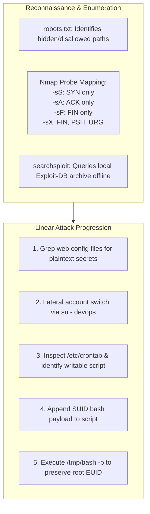

# Assessment Documentation: Module 18 Topic Transition Recap

---

## 1. Unified Metadata Header
- **Assessment Title:** Topic Transition Recap (Jr Pentester Challenges)
- **Learning Path:** Jr Penetration Tester
- **Module:** Module 18: Jr Pentester Challenges
- **Room Sequence:** Room 08 of 08 (Grand Capstone of the Learning Path)
- **Recap ID:** `6afe01c8b7a1485ac0cf8ade`
- **Assessment Type:** Knowledge Synthesis & Skill Verification
- **Official URL:** [https://tryhackme.com/recap/6afe01c8b7a1485ac0cf8ade](https://tryhackme.com/recap/6afe01c8b7a1485ac0cf8ade)
- **User Completion Status:** 100% Completed (48 / 48 Points, Score: 100%)

---

## 2. Executive Summary & Assessment Scope
The **Topic Transition Recap** for Module 18 stands as the grand finale assessment of the entire TryHackMe **Jr Penetration Tester** Learning Path. It evaluates comprehensive offensive security knowledge across multiple operational domains: intelligence gathering via web crawling directives (`robots.txt`), local air-gapped vulnerability discovery using `searchsploit`, low-level TCP protocol flag mechanics in `nmap`, full cyber kill-chain execution (from web config secret extraction to lateral account switching and root cron exploitation), and the internal security mechanics of the GNU Bash shell when preserving effective privileges through the `-p` switch.

---

## 3. Learning Objectives & Core Knowledge Domains
1. **Attack Chain Progression:** Understanding the precise chronological and logical order of penetration testing actions moving from a web foothold to administrative takeover.
2. **Bash SUID Privilege Preservation:** Demystifying how modern Linux shells drop elevated effective user IDs (`EUID`) and how the `-p` flag preserves them.
3. **Air-gapped Exploit Architecture:** Recognizing how offline penetration testing environments utilize local archives of Exploit-DB rather than live web queries.
4. **Passive Web Reconnaissance:** Exploiting crawler directives in `robots.txt` to uncover developer-hidden endpoints.
5. **Transport Layer Probe Analysis (RFC 793):** Mapping specific probe types (`-sA`, `-sS`, `-sX`, `-sF`) to their exact TCP header flags.
6. **Operating System Diagnostics:** Discerning the critical distinction between permission refusal (`Permission denied`) and resource nonexistence (`No such file or directory`).

---

## 4. Assessment Concept Architecture Diagram



---

## 5. Vulnerability Matrix & CWE Mappings

| Evaluated Concept | Target Vector | CWE ID | MITRE ATT&CK ID | Significance |
|-------------------|---------------|--------|-----------------|--------------|
| Cleartext Passwords in Configs | `/var/www/html/config.php` | CWE-798: Hard-coded Credentials | T1552.001: Credentials in Files | High |
| Insecure File Permissions on Cron Jobs | `/etc/crontab` scheduled scripts | CWE-732: Incorrect Permissions | T1053.003: Scheduled Task: Cron | Critical |
| SUID Privilege Misconfiguration | `/tmp/bash` with SUID bit | CWE-250: Execution with Unnecessary Privileges | T1548.001: Setuid and Setgid | Critical |
| Disallowed Directory Disclosure | `/robots.txt` | CWE-200: Information Exposure | T1592: Gather Victim Info | Low |
| Anomaly Probe Network Mapping | Nmap TCP scanning | CWE-436: Interpretation Conflict | T1046: Network Service Discovery | Informational |

---

## 6. Detailed Question Analysis & Solutions

### Question 1: Order Steps from Foothold to Root via Cron Flaw
- **Verified Order:**
  1. `grep the web root config files for password strings`
  2. `Run su - devops with the recovered password`
  3. `Inspect /etc/crontab and permissions of scheduled scripts`
  4. `Append a SUID bash payload to the writable cron script`
- **Technical Breakdown:** An attacker must first harvest existing local secrets from reachable web application files. The recovered password enables lateral movement to a user account (`devops`). From there, auditing scheduled jobs reveals a root cron script that is world-writable, allowing payload injection.

### Question 2: Preserving Privileged SUID in Bash
- **Verified Answer:** `/tmp/bash -p`
- **Technical Breakdown:** When `/bin/bash` executes with `EUID != RUID`, it defaults to dropping the effective user ID unless the `-p` (privileged) flag is supplied. Running `/tmp/bash -p` bypasses privilege dropping and keeps `euid=0(root)`.

### Question 3: Searchsploit Operation Without Internet
- **Verified Answer:** `A local offline copy of the Exploit-DB archive`
- **Technical Breakdown:** The `searchsploit` command queries a pre-installed, offline CSV index and exploit mirror located at `/usr/share/exploitdb/`. No network or CVE feeds are queried.

### Question 4: Strategic Value of robots.txt
- **Verified Answer:** `It often names paths the owner wanted hidden from indexing`
- **Technical Breakdown:** Webmasters frequently add internal, admin, or staging directories to `Disallow` directives in `robots.txt` to prevent public search engines from indexing them, inadvertantly providing penetration testers with high-value targets.

### Question 5: TCP Probe Flag Mappings
- **Verified Mappings:**
  - `-sA` <--> `Only the ACK flag set`
  - `-sS` <--> `Only the SYN flag set`
  - `-sX` <--> `FIN, PSH and URG flags set`
  - `-sF` <--> `Only the FIN flag set`

### Question 6: Error Distinction (Permission Denied vs Missing File)
- **Verified Answer:** `False`
- **Technical Breakdown:** A `Permission denied` error explicitly confirms that the file exists and is located at that path, but the reading process lacks appropriate discretionary access control permissions. If the file did not exist, Linux would output `No such file or directory`.

---

## 7. Command Cheat Sheet & Essential Reference

```bash
# 1. Harvest passwords from web roots
grep -ri "password" /var/www/html/

# 2. Switch user laterally
su - devops

# 3. Audit cron schedules
cat /etc/crontab

# 4. SUID Bash escalation and execution
cp /bin/bash /tmp/bash && chmod +s /tmp/bash
/tmp/bash -p

# 5. Offline vulnerability search
searchsploit "OpenSSH 7.2p2"

# 6. Advanced Nmap scan types
nmap -sS -p- <TARGET>
nmap -sA -p 80 <TARGET>
nmap -sF -p 80 <TARGET>
nmap -sX -p 80 <TARGET>
```

---

## 8. Hardening & Defensive Engineering
1. **Restrict Configuration Access:** Enforce least-privilege permissions on all sensitive configuration files (`chmod 600` or `chmod 640`).
2. **Secure Scheduled Tasks:** Ensure root cron tasks execute only immutable scripts owned by `root:root` with permissions `755` or stricter.
3. **Audit SUID Binaries:** Routinely search for rogue SUID files across the filesystem using `find / -perm -4000 2>/dev/null`.
4. **Sanitize Web Public Directives:** Never list sensitive, administrative, or unauthenticated internal paths in public `robots.txt` files.

---

## 9. References & Further Reading
- [TryHackMe Assessment: Module 18 Topic Transition Recap](https://tryhackme.com/recap/6afe01c8b7a1485ac0cf8ade)
- [GNU Bash Reference Manual](https://www.gnu.org/software/bash/manual/bash.html)
- [Nmap TCP Scan Specification](https://nmap.org/book/man-port-scanning-techniques.html)
- [Recap Questions Breakdown (RECAP-QUESTIONS.md)](file:///e:/THM-JR-PENETRATION-TESTER/18-JR-PENTESTER-CHALLENGES/08-TOPIC-TRANSITION-RECAP/RECAP-QUESTIONS.md)
