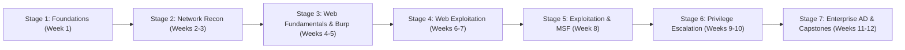

# Sequential Learning Roadmap: TryHackMe Jr Penetration Tester
## خارطة الطريق التعليمية والمسار الزمني للمتعلم

---

### 🚀 Recommended Phased Progression | المراحل الزمنية للدراسة والمراجعة

---

### 📅 Phase 1: Ethical & Methodological Foundations (Week 1)
* **Goal:** Understand legal boundaries, client rules of engagement, and industry assessment methodologies.
* **Core Rooms:**
  1. `pentestingfundamentals`
  2. `principlesofsecurity`
  3. `diveintopentesting`
  4. `cyberkillchain`
  5. `pentestingframeworks`
* **Deliverable:** Clear comprehension of the 7 kill chain stages and ability to define scopes and RoE.

---

### 📅 Phase 2: Reconnaissance & Port Scanning (Weeks 2–3)
* **Goal:** Map an attack surface without triggering unnecessary alarms or missing stealth services.
* **Core Rooms:**
  1. `passiverecon` & `activerecon`
  2. `nmap01` (Live Host Discovery)
  3. `nmap02` (Basic Port Scans)
  4. `nmap03` (Advanced Scans & Filter Evasion)
  5. `nmap04` (NSE & Version Detection)
  6. `protocolsandservers` & `protocolsandservers2`
  7. `netsecchallenge` (Capstone)
* **Deliverable:** Proficiency in running comprehensive Nmap scans, interpreting raw packet states (SYN-ACK vs RST), and evading basic packet filters.

---

### 📅 Phase 3: Web Security Fundamentals & Interception (Weeks 4–5)
* **Goal:** Understand how web applications process requests and master traffic manipulation.
* **Core Rooms:**
  1. `walkinganapplication`
  2. `contentdiscovery`
  3. `subdomainenumeration`
  4. `modernwebstacks`
  5. `burpsuitebasics`
  6. `burpsuiterepeater`
  7. `burpsuiteintruder`
  8. `burpsuiteom`
  9. `burpsuiteextender`
* **Deliverable:** Fast discovery of unlinked directories and full command over Burp Suite Repeater/Intruder workflows.

---

### 📅 Phase 4: Web Application Exploitation (Weeks 6–7)
* **Goal:** Execute manual and semi-automated attacks against critical web application vulnerabilities.
* **Core Rooms:**
  1. `authenticationbypass`
  2. `idor`
  3. `fileinclusion`
  4. `ssrfqi`
  5. `xss`
  6. `commandinjection`
  7. `sqlinjection`
* **Deliverable:** Ability to exploit SQL injection for data extraction, achieve RCE through file inclusion and command injection, and bypass access control flaws.

---

### 📅 Phase 5: Exploit Research & Metasploit Framework (Week 8)
* **Goal:** Transition from discovery to controlled exploitation using industry exploit tooling.
* **Core Rooms:**
  1. `vulnerabilities101`
  2. `exploitvulnerabilities`
  3. `vulnerabilitycapstone`
  4. `metasploitintro`
  5. `metasploitexploitation`
  6. `meterpreter`
* **Deliverable:** Locating public CVE exploits using `searchsploit`, adapting exploit code, deploying Metasploit handlers, and interacting with Meterpreter sessions.

---

### 📅 Phase 6: Post-Exploitation & Privilege Escalation (Weeks 9–10)
* **Goal:** Stabilize initial shell access and systematically escalate permissions to administrative levels.
* **Core Rooms:**
  1. `whattheshell`
  2. `linprivesc`
  3. `winprivesc`
* **Deliverable:** Spawning fully interactive TTY shells (Python PTY, Socat) and abusing Linux SUID/sudo and Windows unquoted service paths and tokens.

---

### 📅 Phase 7: Active Directory & Enterprise Capstones (Weeks 11–12)
* **Goal:** Assess internal enterprise environments, enumerate domain trust relationships, and move laterally.
* **Core Rooms:**
  1. `activedirectorybasics`
  2. `breachingad`
  3. `enumeratingad`
  4. `lateralmovementad`
* **Deliverable:** Analyzing attack graphs via BloodHound, harvesting Kerberos credentials, and demonstrating domain dominance.
