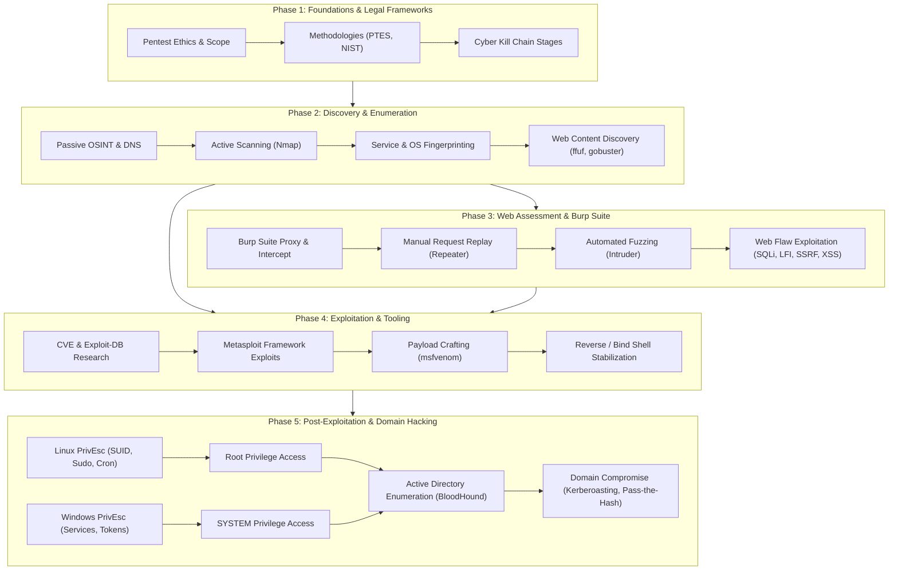

# Practical Skill Map: TryHackMe Jr Penetration Tester
## خريطة المهارات والجدارات العملية لمختبر الاختراق

---

### 🗺️ Overview | نظرة عامة
This skill map visualizes the progression of practical competencies acquired across the **Jr Penetration Tester** curriculum. It bridges academic theory with field-deployable technical capabilities required during red teaming, penetration testing, and CTF competitions.

---

### 📊 Competency Matrix | مصفوفة الجدارات العملية

| Domain | Key Capabilities | Relevant Tools | Rooms Mapped |
|---|---|---|---|
| **Engagement Planning** | Scoping, ROE, Risk Scoring ($T \times V = R$), Legal Boundaries | Markdown, Reporting Templates | `pentestingfundamentals`, `principlesofsecurity`, `diveintopentesting`, `pentestingframeworks` |
| **Network Reconnaissance** | Host discovery, firewall evasion, banner grabbing, NSE scripting | `nmap`, `dig`, `whois`, `netcat`, `tcpdump` | `passiverecon`, `activerecon`, `nmap01` to `nmap04`, `netsecchallenge` |
| **Web Enumeration** | Virtual host fuzzing, directory brute-forcing, JavaScript source auditing | `gobuster`, `ffuf`, Browser DevTools, `curl` | `walkinganapplication`, `contentdiscovery`, `subdomainenumeration`, `modernwebstacks` |
| **Proxy & Traffic Auditing** | Request interception, payload fuzzing, entropy verification, token analysis | `burpsuite` (Repeater, Intruder, Decoder, Sequencer) | `burpsuitebasics`, `burpsuiterepeater`, `burpsuiteintruder`, `burpsuiteom` |
| **Application Exploitation** | SQL Injection, Remote Code Execution, Path Traversal, SSRF, XSS, IDOR | Custom Python, Burp Suite, SQLmap | `authenticationbypass`, `idor`, `fileinclusion`, `ssrfqi`, `xss`, `commandinjection`, `sqlinjection` |
| **Vulnerability Research** | CVE lookup, CVSS rating, proof-of-concept compilation & adaptation | `searchsploit`, Exploit-DB, NVD | `vulnerabilities101`, `exploitvulnerabilities`, `vulnerabilitycapstone` |
| **Exploitation Frameworks** | MSF handler orchestration, staged payloads, auxiliary scanners | `msfconsole`, `msfvenom` | `metasploitintro`, `metasploitexploitation`, `meterpreter` |
| **Interactive Shells** | Terminal stabilization, encrypted tunnels, Socat TTY, PTY spawning | `nc`, `socat`, `python3 -m pty`, `stty` | `whattheshell` |
| **Host Privilege Escalation** | SUID abuse, sudo misconfiguration, unquoted service paths, token theft | LinPEAS, WinPEAS, GTFOBins, PowerUp | `linprivesc`, `winprivesc` |
| **Enterprise AD Operations** | LDAP enumeration, Kerberos attacks (AS-REP, Kerberoasting), Pass-the-Hash | BloodHound, Impacket, Mimikatz | `activedirectorybasics`, `breachingad`, `enumeratingad`, `lateralmovementad` |
